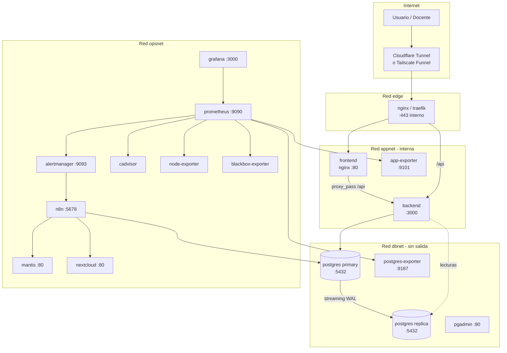
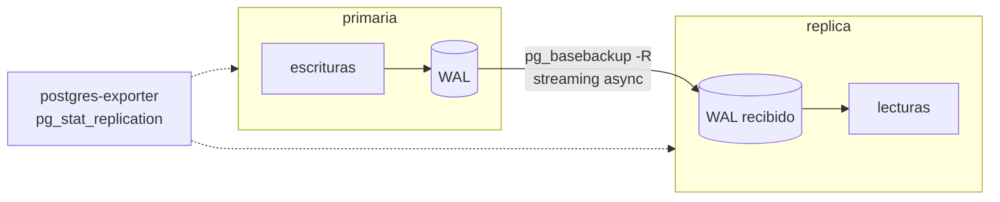
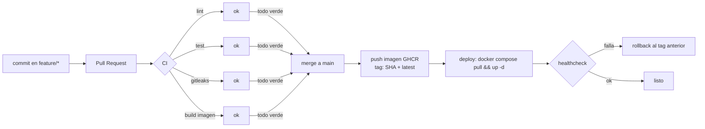
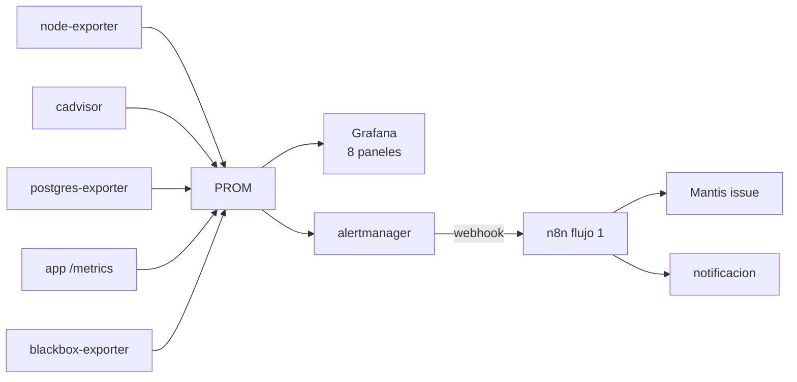
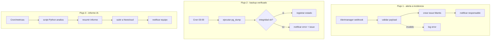

# Arquitectura objetivo

Diagramas en Mermaid (se renderizan en GitHub, VS Code y Obsidian; si el informe final va en PDF,
exportarlos como PNG y referenciarlos).

## 1. Red Docker y servicios



Reglas duras:
- `dbnet` **no** tiene `ports:` hacia el host. Solo `expose`.
- `pgadmin`, `prometheus`, `grafana`, `n8n`, `mantis`, `nextcloud` **no** publican puertos al host
  salvo en el perfil `dev`; en `prod` se llega por el túnel y con auth.
- `5432` nunca aparece en la URL pública. Es requisito explícito de §9.

## 2. Replicación



- Método: **streaming replication asíncrona** con `pg_basebackup -R`.
- `synchronous_commit=on` en primaria (integridad > latencia para este caso).
- **No hay failover automático.** Sin Patroni/repmgr no se promueve nada solo.
  §6 lo permite explícitamente: "si el equipo afirma contar con failover automático, deberá demostrarlo".
  Nosotros declaramos **failover manual documentado** y lo probamos.
- Métricas expuestas: `pg_stat_replication` (lag en bytes), `pg_last_wal_replay_lsn()`.

## 3. CI/CD



- Sin secretos en el repo: todo en GitHub Secrets.
- El pipeline **debe fallar** si el test falla (se prueba con un commit roto a propósito → evidencia §8).
- Deploy: `self-hosted` runner o SSH desde el workflow. Rollback = redeploy del tag anterior (~1-2 min).

## 4. Monitoreo



Paneles obligatorios (§10): CPU, memoria, disco, red, estado/reinicios de contenedores,
disponibilidad de la app, métricas de DB, conexiones activas y consultas lentas,
estado de replicación.

> Advertencia que el enunciado marca explícitamente: **no afirmar** que se monitorean consultas
> SQL individuales si solo hay métricas agregadas del motor. El panel se llama
> "DB – métricas del motor", no "consultas SQL".

## 5. n8n



Los 3 flujos usan **credenciales de n8n** (no secretos hardcodeados) y webhooks con header token.

## 6. Publicación en Internet (implementada)

```
Internet
   │ HTTPS 443
   ▼
Cloudflare (borde: TLS, DDoS, oculta la IP del origen)
   │ túnel saliente QUIC/HTTP2  ← el host no abre puertos
   ▼
cloudflared
   ├──▶ frontend:80 ──▶ backend:3000 ──▶ db:5432
   └──▶ edge:8080/8081 ──▶ pgAdmin / Mantis (HTTP Basic)
```

| Servicio | Ruta pública | Autenticación |
|---|---|---|
| Aplicación | `https://<random>.trycloudflare.com` | login propio (JWT) |
| pgAdmin | `https://<random>.trycloudflare.com` | Basic auth + login de pgAdmin |
| Mantis | `https://<random>.trycloudflare.com` | Basic auth + login de Mantis |

Ningún puerto del host está publicado fuera de loopback: `nmap` desde la LAN devuelve
**todos los puertos `filtered`** y desde Internet solo se ve el 443 de Cloudflare
(`evidence/09/nmap.log`).

| Opción | Costo | HTTPS | Pros | Contras |
|---|---|---|---|---|
| **Cloudflare Tunnel** (elegida) | Gratis | Automático | No abre puertos, no expone IP, borde con DDoS | Depende de Cloudflare; el túnel rápido es efímero |
| Tailscale Funnel | Gratis | Automático | Simple, identidad por dispositivo | Requiere cuenta; URL `ts.net`; sin borde DDoS |
| VPS | Pago | Manual (Caddy/LE) | Control total | Costo; el enunciado no lo exige |

**Plan B**: Tailscale Funnel quedó **documentado, no implementado** — requiere cuenta y un
`tailscale up` interactivo, igual que un túnel con nombre de Cloudflare requiere dominio propio. No
se declara como probado porque no lo está (`docs/informe/10-publicacion.md` §7).

Riesgo asumido: si el túnel cae, la app queda inaccesible. Es una dependencia de un tercero,
declarada en el informe y en la matriz de riesgos.
