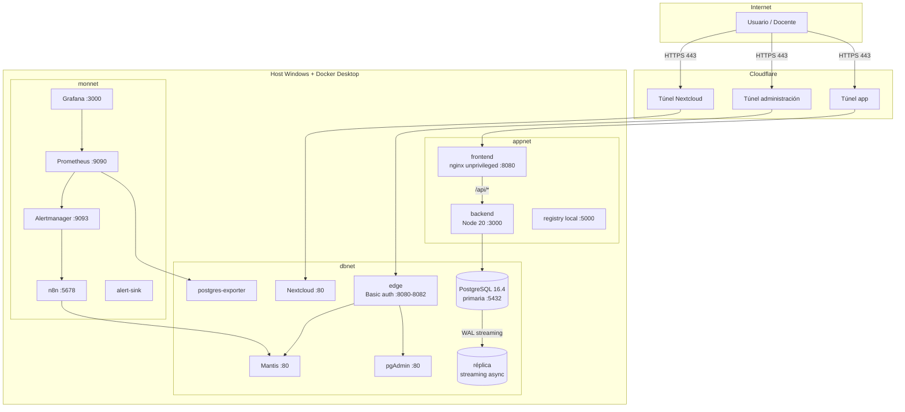
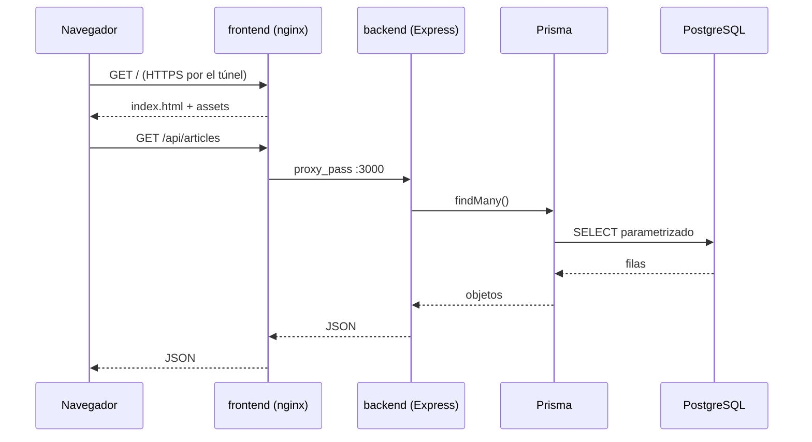
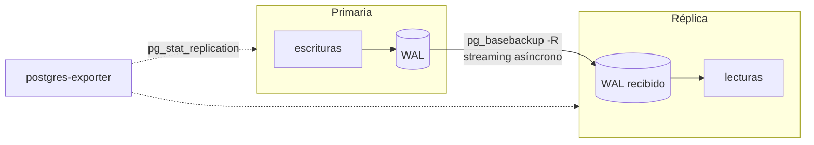
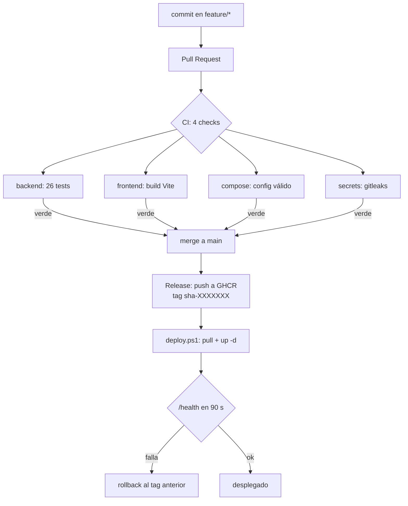
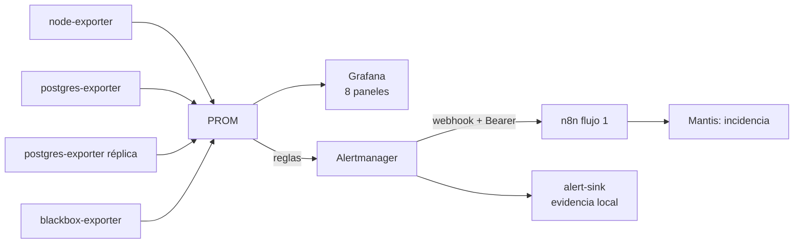
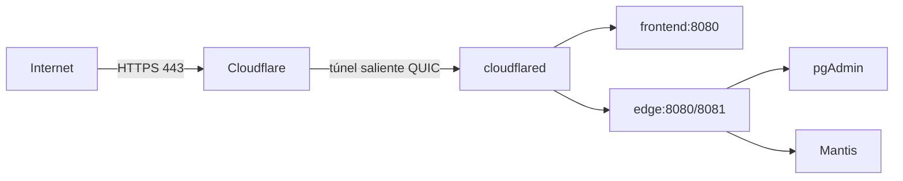

# Práctica Integradora Final 2026 — Informe técnico consolidado

Repositorio: https://github.com/TomasGudi/HIA-2026  
Fecha: 17 de noviembre de 2026

> Generado con `python scripts/informe.py`. No editar a mano.

---

# 01 — Descripción de la aplicación

## 1. Qué es

**Conduit** es una aplicación web de publicación de artículos (blog social tipo Medium) que
implementa el contrato de API **RealWorld**: usuarios, artículos, etiquetas, comentarios,
favoritos y seguimiento entre usuarios. Es el caso de estudio que la comunidad RealWorld usa
para comparar implementaciones de stacks completos.

El proyecto del integrador **reutiliza el backend** de referencia
(`node-express-realworld-example-app`, MIT) y **reescribe la capa de presentación** con Vite +
React 18 (ver `docs/05-decisiones.md` D-18). El dominio, el esquema relacional y el contrato de
API son los de la aplicación existente.

## 2. Usuarios y permisos

| Rol | Puede | No puede |
|---|---|---|
| **Visitante** (sin sesión) | Ver listado de artículos, filtrar por etiqueta, leer un artículo y sus comentarios | Publicar, comentar, favoritear |
| **Usuario registrado** | Todo lo anterior + publicar artículos, comentar, marcar favoritos, editar su perfil | Editar o borrar artículos de otros |
| **Administrador de infraestructura** | Acceder a pgAdmin, Grafana, n8n y Mantis **por túnel** | Acceder desde Internet sin autenticación |

## 3. Funcionalidades

| # | Funcionalidad | Origen | Estado |
|---|---|---|---|
| F1 | Registro e inicio de sesión con JWT | heredada (backend) | operativa |
| F2 | Listado paginado de artículos | heredada | operativa |
| F3 | Filtro por etiqueta | heredada | operativa |
| F4 | Detalle de artículo con comentarios | heredada | operativa |
| F5 | Publicación de artículos con etiquetas | heredada | operativa |
| F6 | Comentarios sobre artículos | heredada | operativa |
| F7 | Favoritos por usuario | heredada (API) | API operativa; botón en UI: pendiente |
| F8 | Perfil de usuario y seguimiento | heredada (API) | API operativa; pantalla: pendiente |
| F9 | Feed de autores seguidos | heredada (API) | API operativa; pantalla: pendiente |
| F10 | Interfaz SPA con rutas y proxy `/api` | **reescrita** | operativa |
| F11 | Endpoint `/healthz` para monitoreo | **agregada** | operativa |
| F12 | Dataset sintético de 6M por tabla de volumen | **agregada** | operativa |

Las funcionalidades F7–F9 existen en la API y son parte del contrato, pero la interfaz de
demostración prioriza los flujos que se muestran en la defensa. Se declaran como alcance parcial
en `docs/informe/16-limitaciones.md` en lugar de figurar como terminadas.

## 4. Alcance del integrador

| Se modifica | Se agrega |
|---|---|
| Conexión a PostgreSQL por variables de entorno | Contenerización completa (DB, backend, frontend) |
| Validación obligatoria de `JWT_SECRET` | Réplica streaming + failover manual |
| Capa de presentación (reescrita) | Dataset masivo + 8 consultas optimizadas |
| — | CI/CD, monitoreo, backups, incidencias, n8n, seguridad |

## 5. Diagnóstico técnico inicial y plan de mejoras

Hallazgos sobre el estado recibido (antes de intervenir), con su tratamiento.

| # | Hallazgo | Categoría | Impacto | Mejora aplicada | Sección |
|---|---|---|---|---|---|
| H1 | `JWT_SECRET` con fallback `'superSecret'`: si la variable falta, la API firma tokens con una clave pública conocida | Seguridad | **Crítico** | `getJwtSecret()` con fail-fast; sin fallback | §14 |
| H2 | El frontend hardcodea `https://conduit.productionready.io/api` | Configuración | Alto | URL por variable de entorno + proxy de nginx | §7 |
| H3 | Frontend con `react-scripts 1.1.1` (2018), sin lockfile: build no reproducible | Mantenibilidad | Alto | Reescritura con Vite 5 + lockfile | §7/§8 |
| H4 | El upstream no trae Dockerfile ni compose utilizable | Despliegue | Alto | Imágenes multi-stage + compose | §4/§7 |
| H5 | Sin réplica, sin backups, sin procedimiento de recuperación | Disponibilidad | Alto | Réplica streaming + backup verificado | §6/§15 |
| H6 | Sin observabilidad: no hay `/metrics` ni logs estructurados | Operación | Alto | Prometheus + exporters + dashboards | §10 |
| H7 | Índices solo los implícitos del ORM; ninguna estrategia de consultas | Rendimiento | Medio | 8 consultas medidas antes/después | §5 |
| H8 | Esquema sin migraciones versionadas (depende de `db push`) | Mantenibilidad | Medio | `db/init/*.sql` versionado en el repo | §4 |
| H9 | Sin tests de integración contra una base real | Calidad | Medio | Suite de humo + CI con DB de servicio | §8 |
| H10 | Credenciales en variables de entorno sin rotación documentada | Seguridad | Medio | `.env` fuera del repo + rotación + gitleaks | §3/§14 |
| H11 | Sin límites de recursos ni healthchecks en contenedores | Operación | Bajo | `healthcheck` y límites por servicio | §4/§10 |
| H12 | `log_connections=off`: sin rastro de accesos a la base | Auditoría | Bajo | Se documenta como decisión consciente de rendimiento | §14 |

## 6. Evidencia

| Evidencia | Archivo |
|---|---|
| Procedencia y commit del código heredado | `app/UPSTREAM.txt` |
| Inventario de versiones | `docs/informe/03-inventario-tecnologico.md` |
| Diagrama de arquitectura | `docs/02-arquitectura.md` |
| Decisiones sobre el frontend | `docs/05-decisiones.md` D-18 |

---

# 02 — Arquitectura general

Este documento describe **lo que está desplegado hoy**, no la arquitectura ideal. Cada componente
de los diagramas existe en `compose.yaml` y se puede verificar con `docker compose ps`.

## 1. Vista de despliegue



Cinco contenedores de aplicación (`frontend`, `backend`, `db`, `db-replica`, `pgadmin`) y ocho de
operación (`mantis`, `nextcloud`, `prometheus`, `alertmanager`, `grafana`, `n8n`, `edge`, `registry`),
más cuatro exporters. Todos los puertos publicados están en `127.0.0.1`.

## 2. Componentes y responsabilidades

| Componente | Responsabilidad | Tecnología | Puerto |
|---|---|---|---|
| `frontend` | SPA; sirve estático y proxea `/api` al backend | Vite 5 + React 18 → nginx 1.27 unprivileged | `127.0.0.1:8090` |
| `backend` | API REST del dominio; JWT; healthcheck con ping a la base | Node 20 + Express 4 + Prisma 4 | ninguno (`expose 3000`) |
| `db` | Persistencia y origen de la replicación | PostgreSQL 16.4 | `127.0.0.1:5433` |
| `db-replica` | Réplica de solo lectura por streaming asíncrono | PostgreSQL 16.4 | ninguno |
| `pgadmin` | Administración de la base | pgAdmin 8 | `127.0.0.1:8080` |
| `mantis` | Gestión de incidencias (§11) | MantisBT 2.28.4 sobre PostgreSQL | `127.0.0.1:8081` |
| `nextcloud` | Gestión documental con permisos por grupo (§12) | Nextcloud 30 sobre PostgreSQL | `127.0.0.1:8082` |
| `prometheus` | Recolección y evaluación de reglas | Prometheus 2.54 | `127.0.0.1:9090` |
| `alertmanager` | Agrupación, silencios y envío a n8n | Alertmanager 0.27 | `127.0.0.1:9093` |
| `grafana` | 8 paneles de observabilidad | Grafana 11 | `127.0.0.1:3001` |
| `n8n` | Automatización: alerta → incidencia | n8n 1.68 | `127.0.0.1:5678` |
| `edge` | Borde con Basic auth para las herramientas administrativas | nginx 1.27 | `127.0.0.1:8088-8091` |
| `registry` | Plan B de imágenes (si GHCR no está disponible) | registry 2 | `127.0.0.1:5000` |

## 3. Redes y exposición

| Servicio | Redes | Puerto publicado | Justificación |
|---|---|---|---|
| `frontend` | `appnet` | `127.0.0.1:8090` | único punto de entrada de la app |
| `backend` | `appnet`, `dbnet` | **ninguno** (`expose 3000`) | solo alcanzable desde el frontend |
| `db` | `dbnet` | `127.0.0.1:5433` | acceso local para desarrollo; en prod no se publica |
| `db-replica` | `dbnet` | **ninguno** | solo lectura, sin exposición |
| `pgadmin` | `dbnet` | `127.0.0.1:8080` | administración, jamás expuesta a Internet |
| `mantis` | `dbnet` | `127.0.0.1:8081` | perfil `ops`; acceso por el borde |
| `nextcloud` | `dbnet` | `127.0.0.1:8082` | perfil `ops`; túnel directo (login propio) |
| `prometheus` | `monnet`, `appnet`, `dbnet` | `127.0.0.1:9090` | necesita scrapear exporters de las tres redes |
| `n8n` | `appnet`, `dbnet`, `monnet` | `127.0.0.1:5678` | recibe webhooks y escribe en Mantis y en su base |

Las tres redes están aisladas entre sí: `appnet` no ve la base, `monnet` solo se cruza con las otras
para scrapear. `dbnet` **no** tiene `internal: true` porque el contenedor necesita resolver el DNS
de Docker y salir a Internet para `apt`/`npm` durante el build (decisión D-15).

Todas las publicaciones son en **loopback**: no hay un solo puerto escuchando en `0.0.0.0`.

## 4. Flujo de una petición



Un solo origen ⇒ **no hace falta CORS** (el `cors()` del backend queda como red de seguridad para
clientes externos, no como solución de arquitectura). El frontend agrega las cabeceras de seguridad
y el rate limit de `/api/` antes de llegar al backend.

## 5. Replicación



- Método: **streaming replication asíncrona** con `pg_basebackup -R`.
- `synchronous_commit=on` en la primaria: se prioriza integridad sobre latencia.
- **No hay failover automático.** Sin Patroni/repmgr nada se promueve solo. La promoción es manual,
  documentada y medida: **RTO 8,6 s** (§8).
- Métricas: `pg_stat_replication` (lag en bytes) y `pg_last_wal_replay_lsn()`.

## 6. CI/CD



`main` está protegida con los 4 checks en modo estricto y `enforce_admins`. El deploy es
**pull-based**: el host baja la imagen de GHCR y verifica `/health`; si no responde, vuelve sola al
tag anterior (`.deploy/state.json` guarda el historial).

## 7. Monitoreo y alertas



Reglas activas: `ServicioCaido` (2 min), `CPUAlta` (85%, 5 min), `MemoriaAlta` (90%, 5 min),
`DiscoCasiLleno`, `PostgresCaido` (1 min) y `ReplicacionAtrasada` (2 min). El flujo 1 está probado
de punta a punta: alerta real → incidencia #18 en Mantis.

## 8. Publicación en Internet



El host **no abre puertos**: el túnel es saliente. El TLS lo termina Cloudflare. Las herramientas
administrativas quedan detrás de HTTP Basic en `edge`, y además tienen su propio login.

| Servicio | Ruta pública | Autenticación |
|---|---|---|
| Aplicación | `https://<random>.trycloudflare.com` | login propio (JWT) |
| pgAdmin | `https://<random>.trycloudflare.com` | Basic auth + login de pgAdmin |
| Mantis | `https://<random>.trycloudflare.com` | Basic auth + login de Mantis |

## 9. Decisiones estructurales

| Decisión | Motivo | Registro |
|---|---|---|
| Backend sin puerto publicado | reduce superficie; el frontend es el único borde | D-08 |
| Redes separadas `appnet` / `dbnet` / `monnet` | el frontend no debe hablar con la base | §7 |
| Healthcheck con `SELECT 1` | un contenedor "up" con la base caída no es un servicio sano | §7 |
| Imágenes multi-stage | la imagen final no lleva toolchain ni devDependencies | §14 |
| Frontend unprivileged (uid 101, :8080) | un proceso comprometido no corre como root | §14 |
| Mantis en perfil `ops` | no compite por recursos con la demo principal | D-21 |
| Un solo motor (PostgreSQL) | menos superficie y menos servicios que mantener | D-03/D-21 |
| Failover manual | Patroni exige 3 nodos; se declara y se mide | D-04 |

## 10. Estado actual

Todo lo planificado para §6, §7, §9, §10, §12 y §13 está desplegado y verificado. Lo que no está:

- **Flujos 2 y 3 de n8n**: el 2 necesita una imagen con `postgresql-client`; el 3 está implementado
  pero no programado (ver `13-automatizacion.md`).
- **Failover automático**: fuera de alcance por diseño (D-04).

---

# 03 — Inventario tecnológico

Versiones efectivamente usadas (no "la última que había"). Las de runtime están fijadas en los
Dockerfile o en el compose; las de dependencias, en `package-lock.json`.

## Backend

| Componente | Versión | Rol | Nota |
|---|---|---|---|
| Node.js | 20 (imagen `node:20-alpine`) | runtime | LTS; el host tiene Node 26, que no se usa para el build |
| Express | ~4.18.1 | framework HTTP | |
| Prisma Client | ^4.16.1 | ORM | `provider = postgresql` |
| jsonwebtoken | ^9.0.2 | firma de JWT | `HS256`, expiración 60 días |
| express-jwt | ^8.4.1 | middleware de auth | |
| bcryptjs | ^2.4.3 | hash de contraseñas | |
| slugify | ^1.6.0 | slugs de artículos | |
| Nx | 17.2.6 | build del monorepo | build reproducible vía `package-lock.json` |

## Frontend (reescrito, D-18)

| Componente | Versión | Rol |
|---|---|---|
| React / React DOM | ^18.3.1 | UI |
| Vite | ^5.4.8 | build y dev server |
| react-router-dom | ^6.26.2 | ruteo SPA |
| nginx | 1.27-alpine | servidor estático + proxy `/api` |

## Base de datos

| Componente | Versión | Nota |
|---|---|---|
| PostgreSQL | 16.4-alpine | primaria; réplica en §6 |
| pg_stat_statements | extensión incluida | requiere `shared_preload_libraries` |
| pg_buffercache | extensión incluida | inspección de caché |
| pgAdmin | 8 (`dpage/pgadmin4:8`) | administración, solo loopback |
| pgBadger | a definir en §4 | análisis de logs |

## Infraestructura

| Componente | Versión | Nota |
|---|---|---|
| Docker Engine | 29.9.3 | Docker Desktop sobre WSL2 |
| Docker Compose | v5.7.0 | `compose.yaml` |
| Windows | 11 | host de desarrollo |
| WSL2 / Ubuntu | 2 | backend de Docker |

## Servicios previstos (§10, §11, §12, §13)

| Componente | Imagen prevista | Estado |
|---|---|---|
| Prometheus | `prom/prometheus` | pendiente |
| Grafana | `grafana/grafana` | pendiente |
| node-exporter | `prom/node-exporter` | pendiente |
| cAdvisor | `gcr.io/cadvisor/cadvisor` | pendiente |
| postgres-exporter | `prometheuscommunity/postgres-exporter` | pendiente |
| blackbox-exporter | `prom/blackbox-exporter` | pendiente |
| Alertmanager | `prom/alertmanager` | pendiente |
| n8n | `n8nio/n8n` | pendiente |
| Mantis | a definir (soporte PostgreSQL a verificar) | pendiente |
| Nextcloud | `nextcloud` | pendiente |

## Eventos de ciberseguridad considerados al elegir el stack

El enunciado pide explícitamente tener en cuenta los últimos eventos al inventariar el stack.

| Evento | Qué fue | Impacto en nuestras decisiones |
|---|---|---|
| **CVE-2024-4577** (PHP-CGI, Windows) | inyección de argumentos explotada masivamente para ransomware | descarta stacks PHP para los servicios propios; Mantis (PHP) queda aislado y sin exposición pública |
| **GhostAction** (sep. 2025) | robo de secretos desde workflows de GitHub Actions en ~327 repos | secretos solo en GitHub Secrets + `gitleaks` en pre-commit y CI (§3/§8) |
| **xz-utils / backdoor en cadena de suministro** (2024) | puerta trasera en una dependencia de compresión | imágenes con tag fijo, sin `latest`; escaneo con Trivy (§14) |
| **Compromisos de paquetes npm/PyPI** (recurrentes) | malware en dependencias publicadas | lockfile obligatorio y `npm audit` en el pipeline |
| **EOL de Node 8/16 y `react-scripts` antiguo** | runtimes sin parches | se fija Node 20 y se reescribe el frontend (D-18) |

> Verificar con la cátedra cuál evento espera ver citado en el inventario; el informe final debe
> nombrar el mismo en §1 y en §14 para no contradecirse.

## Evidencia

| Evidencia | Archivo |
|---|---|
| Versiones de runtime | `compose.yaml`, `app/*/Dockerfile` |
| Versiones de dependencias | `app/backend/package-lock.json`, `app/frontend/package.json` |
| Versión del motor | `docker compose exec db psql -c 'select version();'` → `evidence/04/version-motor.txt` |

---

# 04 — Manual de instalación

## 1. Objetivo

Levantar el stack completo desde cero en una máquina Windows con Docker Desktop, sin pasos
implícitos. Todo lo que sigue está probado en el equipo de la práctica; los tiempos son los
medidos, no estimaciones.

## 2. Requisitos

| Componente | Versión mínima | Verificación |
|---|---|---|
| Windows | 11 (probado) | `winver` |
| Docker Desktop | 4.30+ con WSL 2 | `docker version` |
| PowerShell | 5.1 (probado) o 7.x | `$PSVersionTable` |
| Git | cualquiera reciente | `git --version` |
| Espacio en disco | **40 GB libres** | 8,5 GB de base + imágenes + backups |
| RAM | 8 GB (16 GB recomendado) | Docker Desktop → Resources |
| Python | 3.11+ (solo scripts auxiliares) | `python --version` |

Recursos asignados a Docker Desktop usados en las pruebas: **6 CPU, 8 GB de RAM, 60 GB de disco**.
Con menos de 4 GB de RAM la carga del dataset puede quedar sin memoria.

## 3. Instalación paso a paso

### Paso 1 — Clonar y entrar al repositorio

```powershell
git clone https://github.com/TomasGudi/HIA-2026.git
cd HIA-2026
git checkout main
```

### Paso 2 — Crear el `.env`

```powershell
Copy-Item .env.example .env
```

Editar `.env` y **cambiar todas** las contraseñas. Las que no son opcionales:

| Variable | Para qué | Regla |
|---|---|---|
| `POSTGRES_PASSWORD` | usuario administrador de la base | ≥ 16 caracteres |
| `APP_DB_PASSWORD` | rol `app` de la aplicación (solo DML) | ≥ 16 caracteres |
| `REPL_PASSWORD` | replicación | ≥ 16 caracteres |
| `JWT_SECRET` | firma de sesiones | **≥ 32 caracteres** |
| `MANTIS_CRYPTO_SALT` | cifrado interno de Mantis | ≥ 32 caracteres |
| `MANTIS_API_TOKEN` | token de la API de Mantis | **exactamente 32 caracteres** |
| `N8N_WEBHOOK_TOKEN` | autenticación del webhook | ≥ 32 caracteres |
| `EDGE_ADMIN_PASSWORD` | Basic auth del borde administrativo | ≥ 16 caracteres |

Generar valores aleatorios:

```powershell
python -c "import secrets; print(secrets.token_urlsafe(24))"
```

> `MANTIS_API_TOKEN` es la única con longitud fija: Mantis rechaza tokens que no tengan 32
> caracteres. Si se cambia, hay que regenerarlo también en la UI de Mantis.

### Paso 3 — Base de datos

```powershell
docker compose up -d db pgadmin
docker compose ps
```

Esperar a que `db` esté `healthy` (healthcheck con `pg_isready`). El primer arranque ejecuta
`db/init/` en orden: esquema, extensiones, usuario de monitoreo, usuario de replicación y rol
`app` con privilegios mínimos.

### Paso 4 — Cargar el dataset

```powershell
./scripts/db.ps1 seed       # ~13 min: 24,2 M de filas
./scripts/db.ps1 indexes    # DESPUÉS de la carga, no antes
./scripts/db.ps1 stats
```

Los índices se crean **después** de la carga a propósito: crearlos antes multiplica el tiempo de
inserción sin mejorar nada. `stats` debe mostrar las tablas de volumen con 6.000.001 filas.

### Paso 5 — Aplicación

```powershell
docker compose up -d backend frontend
curl.exe http://127.0.0.1:8090/health
```

Respuesta esperada: `{"status":"ok","db":"up","version":"dev"}`.

### Paso 6 — Réplica (opcional para desarrollo, obligatoria para §6)

```powershell
docker compose up -d db-replica
./scripts/replica.ps1 status    # debe mostrar state=streaming
./scripts/replica.ps1 test      # escritura en primaria + lectura en réplica
```

### Paso 7 — Servicios de operación

```powershell
docker compose --profile ops up -d
```

Levanta Mantis, Prometheus, Alertmanager, Grafana, exporters, n8n, el borde administrativo y el
registro local. Sin `--profile ops` el stack queda en modo mínimo (solo app + base).

### Paso 8 — Verificación integral

```powershell
./scripts/monitoreo.ps1 status
./scripts/publicar.ps1 up
```

`publicar.ps1` imprime las URLs de los túneles. Son **efímeras**: cambian en cada arranque.

## 4. Verificación

| Qué | Comando | Resultado esperado |
|---|---|---|
| Contenedores | `docker compose ps` | todos `healthy` o `running` |
| Salud de la app | `curl.exe http://127.0.0.1:8090/health` | `status=ok`, `db=up` |
| Datos | `./scripts/db.ps1 stats` | 6.000.001 filas en tablas de volumen |
| Réplica | `./scripts/replica.ps1 status` | `streaming`, lag < 1 s |
| Monitoreo | `http://127.0.0.1:9090/targets` | todos los targets `UP` |
| Grafana | `http://127.0.0.1:3001` | 8 paneles con datos |
| Mantis | `http://127.0.0.1:8081` | login y proyecto `HIA-2026` |
| n8n | `http://127.0.0.1:5678` | flujo `01-alerta-a-mantis` activo |

## 5. Puertos publicados

Todos en `127.0.0.1`: nada se expone a la LAN.

| Puerto | Servicio | Nota |
|---|---|---|
| 5433 | PostgreSQL primaria | 5432 queda libre para una instalación local |
| 8080 | pgAdmin | |
| 8081 | Mantis | |
| 8090 | Frontend | proxy a `/api/` del backend |
| 3001 | Grafana | |
| 5000 | Registro local de imágenes | plan B de GHCR |
| 5678 | n8n | |
| 8088 / 8089 / 8091 | Borde administrativo | pgAdmin / Mantis / n8n con Basic auth |
| 9090 / 9093 | Prometheus / Alertmanager | |

## 6. Problemas frecuentes

| Síntoma | Causa | Solución |
|---|---|---|
| `db` reinicia en bucle | contraseña con `$` o `#` sin escapar en `.env` | usar `secrets.token_urlsafe` (sin esos caracteres) |
| `frontend` unhealthy | el contenedor escucha en 8080, no en 80 | verificar `docker port pi-frontend` → `8080/tcp` |
| `seed` termina sin filas | volumen ya inicializado con otro esquema | `./scripts/db.ps1 reset` (borra datos) |
| Réplica no arranca | `pg_basebackup` falló por contraseña | `./scripts/replica.ps1 reinit` |
| Mantis da 500 | `MANTIS_CRYPTO_SALT` cambió después de inicializar | restaurar el valor original o recrear el volumen |
| n8n no importa el flujo | la base `n8n` ya tenía workflows | el entrypoint solo importa si la tabla está vacía |
| `deploy.ps1` falla al bajar la imagen | GHCR privado o sin login | usar `-Registry 127.0.0.1:5000` con el registro local |

## 7. Tiempos medidos

| Etapa | Tiempo |
|---|---|
| `docker compose up -d db pgadmin` (primer arranque) | ~40 s |
| `db.ps1 seed` (24,2 M de filas) | ~13 min |
| `db.ps1 indexes` | ~2 min |
| `docker compose --profile ops up -d` | ~90 s |
| Stack completo desde cero | **~18 min** |

## 8. Decisiones

- **Un solo `compose.yaml` con perfiles** en vez de varios archivos: `ops` separa lo que es
  operación de lo que es la aplicación. Ver `docs/05-decisiones.md` (D-03, D-16).
- **Sin `docker-compose.override.yml`**: lo que se prueba es lo que se despliega.
- **Secretos solo en `.env`**: el repo tiene `.env.example` con placeholders y gitleaks en CI.

## 9. Limitaciones

- El manual asume Windows + Docker Desktop. En Linux los comandos son los mismos salvo
  `curl.exe` → `curl` y las rutas de los scripts.
- No se cubre un clúster real: la réplica es un contenedor en el mismo host, no otra máquina.
- La publicación usa túneles rápidos de Cloudflare (URL efímera), no un dominio propio.

## 10. Preguntas frecuentes

**¿Por qué la base no publica el 5432?**
Porque el 5432 suele estar ocupado por un PostgreSQL local y porque publicar el puerto estándar
invita a escaneos. Se usa 5433 y solo en loopback.

**¿Qué pasa si corro `docker compose down -v`?**
Se borra el volumen `pi-pgdata`: hay que repetir el paso 4 (~15 min). Sin `-v`, los datos
sobreviven; está probado en `evidence/04/persistencia.txt`.

**¿Se puede levantar sin la réplica ni el monitoreo?**
Sí. `docker compose up -d` levanta solo app y base. La réplica y `--profile ops` son necesarios
para §6 y §10, no para que la aplicación funcione.

---

# 05 — Configuración Docker

## 1. Servicios

| Servicio | Imagen | Puertos publicados | Redes | Perfil |
|---|---|---|---|---|
| `db` | `postgres:16.4-alpine` | `127.0.0.1:5433` | `dbnet` | — |
| `pgadmin` | `dpage/pgadmin4:8` | `127.0.0.1:8080` | `dbnet` | — |
| `backend` | build `./app/backend` | — (solo `expose 3000`) | `appnet`, `dbnet` | — |
| `frontend` | build `./app/frontend` | `127.0.0.1:8090` | `appnet` | — |
| `mantis` | build `./app/mantis` | `127.0.0.1:8081` | `dbnet` | `ops` |
| `nextcloud` | `nextcloud:30-apache` | `127.0.0.1:8082` | `dbnet` | `ops` |

Regla transversal: **ningún puerto se publica fuera de `127.0.0.1`**. La publicación a Internet
es por túnel (§9), no abriendo puertos.

## 2. Redes

| Red | Para qué | Quién está |
|---|---|---|
| `pi-appnet` | tráfico de la aplicación | `frontend` ↔ `backend` |
| `pi-dbnet` | tráfico de datos | `backend`, `db`, `pgadmin`, `mantis` |

El frontend **no** está en `dbnet`: no tiene por qué hablar con la base. Es segmentación real, no
un dibujo.

> **Aprendizaje (D-15)**: la primera versión declaraba `dbnet` como `internal: true`. Docker
> entonces **descarta silenciosamente** la publicación de puertos: `docker compose up` sale en
> verde, los contenedores están sanos, y `docker port` no muestra nada. Se detectó probando con un
> `nginx` aislado sobre la misma red.

## 3. Volúmenes

| Volumen | Contenido | Consecuencia de perderlo |
|---|---|---|
| `pi-pgdata` | datos de PostgreSQL | se regenera con `scripts/db.ps1 seed` (~13 min) |
| `pi-pgadmin` | configuración de pgAdmin | se reconfigura |
| `pi-mantis-files` | adjuntos de las incidencias | **se pierde la evidencia de §11** |

## 4. Imágenes

### Backend (`app/backend/Dockerfile`)

- Etapa `build`: `node:20` + `npm ci` + `prisma generate` + `nx build`.
- Etapa `runtime`: `node:20-slim` + OpenSSL (lo necesita Prisma) + **solo dependencias de
  producción** (`npm ci --omit=dev` sobre el `package.json` que genera Nx).
- Corre como usuario `node` (no root).
- Healthcheck propio contra `/health`, que hace un `SELECT 1` a la base: un contenedor "up" con la
  base caída no es un servicio sano.

Detalle que costó: el schema de Prisma está en `src/prisma/schema.prisma`, fuera de la ubicación
por defecto, así que el `postinstall` de `@prisma/client` **no** lo detecta. Hay que ejecutar
`npx prisma generate --schema=...` explícito en el build, y copiar `node_modules/.prisma` y
`node_modules/@prisma` a la imagen final.

### Frontend (`app/frontend/Dockerfile`)

- Etapa `build`: `node:20` + `npm ci` + `vite build`.
- Etapa `runtime`: `nginx:1.27-alpine` sirviendo estático (**74 MB**, sin Node adentro).
- `nginx.conf`: SPA fallback, `/healthz`, proxy `/api` → `http://backend:3000` (mismo origen, sin
  CORS abierto) y caché de assets con hash.

## 5. Variables de entorno

Todo por `.env` (nunca versionado) y `.env.example` con placeholders.

| Variable | Uso |
|---|---|
| `POSTGRES_*` | base principal |
| `DB_PORT` | puerto publicado (5433 por colisión con otro stack local, D-16) |
| `JWT_SECRET` | firma de tokens; obligatorio (sin fallback, H1) |
| `MANTIS_*` | base, rol, contraseña del admin y `crypto_master_salt` |
| `SEED_*` | volumen del dataset |

Dentro de la red Docker la base se resuelve como `db:5432`; el 5433 es solo el puerto del host.

## 6. Verificación (evidencia)

| Comprobación | Resultado |
|---|---|
| `docker compose config --quiet` | válido |
| `docker compose ps` | 5 servicios, 3 con healthcheck en `healthy` |
| `GET :3000/health` desde el contenedor | `{"status":"ok","db":"up"}` |
| `GET :8090/` | 200 (SPA) |
| `GET :8090/api/articles?limit=3` | 200, `articlesCount = 6.000.000` |
| Escritura completa (registro → alta → comentario) | 201 / 201 / 200 |

Detalle en `evidence/07/e2e.log`.

## 7. Limitaciones

- El listado público tarda **10,4 s**: es el objetivo principal de §5 (hoy el `count(*)` con
  `JOIN` sobre 6M de filas domina el tiempo).
- No hay límites de CPU/memoria por servicio (`deploy.resources`) todavía: se agregan en §10 para
  que las métricas de cAdvisor sean comparables.
- `frontend` y `backend` se construyen localmente; la publicación en registry llega en §8.

---

# 06 — Migración y carga de datos

## 1. Objetivo

Poblar PostgreSQL con un dataset **sintético** que permita medir rendimiento real (§5), probar
replicación (§6) y ejercitar la aplicación con volumen representativo, sin usar datos personales
reales.

## 2. Método

| Aspecto | Decisión |
|---|---|
| Generación | `generate_series` + aritmética modular (sin `random()`) → **determinista y reproducible** (D-17) |
| Formato | SQL puro (`db/seed/10-seed.sql` para carga completa, `11-seed-bulk.sql` para recargar solo tablas de relación) |
| Integridad | FKs declaradas; durante la carga se desactivan los triggers (`session_replication_role=replica`) y se validan después (D-19) |
| Índices | **no** existen durante la carga; se crean al final (D-14) |
| Restricciones | PK, UNIQUE (`email`, `username`, `slug`, `name`), UNIQUE `(A,B)` en las N:M, CHECK de auto-seguimiento |
| Datos personales | ninguno: emails `userN@example.com`, contraseñas con hash ficticio, textos Lorem ipsum |

### Volumen por tabla

| Tabla | Filas | Rol en el dataset |
|---|---|---|
| `Article` | 6.000.000 | tabla de volumen |
| `Comment` | 6.000.000 | tabla de volumen |
| `_UserFavorites` | 6.000.000 | tabla de volumen (N:M) |
| `_ArticleToTag` | 6.000.000 | relación N:M derivada de los artículos |
| `User` | 200.000 | catálogo con cardinalidad realista |
| `Tag` | 5.000 | catálogo |
| **Total** | **24.205.000** | |

> El enunciado pide "al menos 6.000.000 de registros por tabla de datos que forme parte del
> conjunto de prueba". Se interpreta como **tablas de volumen del dominio** (ver D-05); los
> catálogos se dimensionan con cardinalidad realista porque inflarlos no aporta nada al análisis.

## 3. Tiempos medidos

| Etapa | Filas | Tiempo |
|---|---|---|
| `User` | 200.000 | 1,9 s |
| `Tag` | 5.000 | 0,02 s |
| `Article` | 6.000.000 | **10 min 43 s** |
| `Comment` (6 trozos de 1M) | 6.000.000 | **26,0 s** (3,8 + 4,3 + 4,4 + 4,9 + 5,0 + 5,1) |
| `_UserFavorites` | 6.000.000 | 24,6 s |
| `_ArticleToTag` | 6.000.000 | 29,9 s |
| `ANALYZE` | — | 36,1 s |
| **Total** | 24,2M | **~13 min** |

Evidencia: `evidence/04/seed-carga.log`, `evidence/04/seed-bulk.log`.

### Por qué `Article` tarda 20× más que `Comment` con la misma cantidad de filas

`Article` tiene dos índices UNIQUE (`slug`, y la PK), un cuerpo de ~500 bytes por fila
(`repeat(...)` ×12) y una FK a `User`; además se cargó **antes** de ajustar `max_wal_size`.
`Comment` se cargó sin triggers de FK y con el clúster ya ajustado. Es una comparación honesta
del costo de mantener índices y WAL durante la carga, y se retoma en §5.

## 4. Tamaño final

| Tabla | Datos | Índices | Total |
|---|---|---|---|
| `Article` | 5.210 MB | 722 MB | **5.931 MB** |
| `Comment` | 721 MB | 301 MB | 1.021 MB |
| `_UserFavorites` | 207 MB | 266 MB | 473 MB |
| `_ArticleToTag` | 207 MB | 168 MB | 375 MB |
| `User` | 36 MB | 28 MB | 64 MB |
| `Tag` | 264 kB | 304 kB | 568 kB |
| **Base de datos** | | | **7.874 MB (7,9 GB)** |

Los índices ocupan **~1,5 GB (19 % de la base)**. Ese número es el que hay que justificar cada
vez que se propone un índice nuevo (§5): no es gratis ni en disco ni en escritura.
Evidencia: `evidence/04/volumen.txt`.

## 5. Incidente de carga y su resolución (D-19)

| | |
|---|---|
| **Síntoma** | La inserción de `Comment` quedó 30 min con menos de 1.000 filas cargadas |
| **Causa** | Trigger de FK: `SELECT 1 FROM "User" WHERE id = $1 FOR KEY SHARE` por fila; 6M comentarios contra 200k usuarios → contención de locks de fila |
| **Solución** | `SET session_replication_role = replica` durante la carga + validación posterior de huérfanos |
| **Resultado** | 6M de comentarios en 26 s (mejora de más de dos órdenes de magnitud) |
| **Trade-off** | La integridad deja de estar garantizada por el motor durante la carga; se garantiza por verificación explícita y se documenta |

## 6. Verificación de integridad (evidencia)

Ejecutada al final de la carga, sobre 24M de filas:

| Control | Huérfanos |
|---|---|
| comentarios huérfanos (artículo) | **0** |
| comentarios huérfanos (autor) | **0** |
| favoritos huérfanos | **0** |
| artículo-etiqueta huérfanos | **0** |

Evidencia: `evidence/04/seed-bulk.log` (bloque "VERIFICACION DE INTEGRIDAD").

### Dato extra que sirve para §5

La misma consulta de control de huérfanos tardó **235.324 ms (3 min 55 s) sin índices** y
**3.570 ms con `Comment_articleId_idx`**: 65× menos. No es una consulta del producto, pero
demuestra el efecto de un índice sobre un `LEFT JOIN` de 6M × 6M.

## 7. Parámetros ajustados para la carga (D-20)

| Parámetro | Antes | Después | Motivo |
|---|---|---|---|
| `max_wal_size` | 1 GB (default) | 8 GB | la primera carga generó **38 GB de WAL** por checkpoints frecuentes |
| `checkpoint_timeout` | 5 min (default) | 15 min | menos full-page writes |
| `synchronous_commit` | on | off (solo durante la carga) | durabilidad no crítica en datos regenerables |
| `maintenance_work_mem` | 64 MB | 1 GB (sesión de carga) | `ANALYZE` y creación de índices más rápidos |

Los dos primeros se aplicaron con `ALTER SYSTEM` + `pg_reload_conf()` (sin reinicio) y quedan en
`postgresql.auto.conf`; se revierten o se justifican en el informe de §5.

## 8. Reproducción

```powershell
docker compose up -d db
./scripts/db.ps1 seed      # carga completa (10-seed.sql)
./scripts/db.ps1 indexes   # índices después de la carga
./scripts/db.ps1 stats     # tamaños y conteos
```

Para recargar solo comentarios/favoritos/relaciones:

```powershell
docker compose exec -T db psql -U practica_app -d practica `
  -v articles=6000000 -v comments=6000000 -v favorites=6000000 `
  -f /db/seed/11-seed-bulk.sql
```

## 9. Limitaciones

- `Article.body` es texto repetido: la distribución de longitudes no es realista, así que las
  mediciones de `LIKE`/full-text son optimistas en tamaño pero válidas en forma.
- No hay `_UserFollows` cargado (0 filas): el feed de seguidos se probará con datos insertados
  a mano en §5 si hace falta.
- El dataset **no** se versiona en el repo (7,9 GB): se regenera con los scripts.

---

# 07 — Informe de optimización SQL

## 1. Método

1. Se identificaron las consultas con `pg_stat_statements` (top por tiempo total) y se
   contrastaron con las operaciones reales del backend (Prisma): cada consulta de este informe
   corresponde a una pantalla del producto, no a un ejemplo inventado.
2. Para cada una se capturó `EXPLAIN (ANALYZE, BUFFERS)` y el tiempo de ejecución con la caché
   caliente (segunda corrida).
3. Se aplicó **un cambio por vez**, midiendo el efecto.
4. Se probó también una optimización que **no** funcionó y se descartó con el número en la mano.

Scripts: `db/queries/10-baseline.sql` (antes) y `db/queries/20-optimizado.sql` (después).
Evidencia cruda: `evidence/05/baseline-1.txt`, `evidence/05/optimizado.txt`, `evidence/05/control.txt`.

## 2. Resultado general

| # | Consulta | Antes | Después | Mejora | Cambio aplicado |
|---|---|---|---|---|---|
| Q1 | count del listado público | 656 ms | **5,9 ms** | 111× | conteo acotado (`LIMIT` interno) |
| Q2 | listado paginado (offset 0) | 5,3 ms | 5,3 ms | — | ya óptimo (índice de `createdAt`) |
| Q2b | paginación profunda (offset 500.000) | 1.933 ms | **62,6 ms** | 31× | keyset pagination |
| Q3 | listado filtrado por etiqueta | 134 ms | 134 ms | — | ya óptimo (nested loop con índices) |
| Q4 | etiquetas populares (top 10) | 1.033 ms | **0,69 ms** | 1.497× | vista materializada |
| Q5 | feed de autores seguidos | 8.331 ms | **1,2 ms** | 6.942× | reescritura `IN (subconsulta)` |
| Q6 | detalle + comentarios | 7,5 ms | 7,5 ms | — | ya óptimo (índices únicos) |
| Q7 | top de artículos por favoritos | 3.565 ms | **1,4 ms** | 2.546× | vista materializada |
| Q8 | búsqueda por título (`ILIKE '%…%'`) | 5.292 ms | **3,5 ms** | 1.512× | `pg_trgm` + índice GIN |

**Efecto medido en el producto**: `GET /api/articles` pasó de **7,9 s a 0,19 s** (41×).

## 3. Análisis consulta por consulta

### Q1 — count del listado (656 ms → 5,9 ms)

Plan inicial: `Parallel Hash Join` + `Parallel Index Only Scan` sobre `Article_authorId_idx`
(2.000.000 filas × 3 workers). El join no es el problema: **contar 6M de filas es O(n)** y ningún
índice lo evita.

Decisión: acotar el conteo a 10.000 (la interfaz solo necesita la cantidad de páginas). El plan
corta al alcanzar el tope y baja a 5,9 ms.

> Hallazgo mayor: la consulta que **genera Prisma** para este mismo caso tarda **17,8 s** de
> promedio (5 llamadas en `pg_stat_statements`), contra 656 ms del SQL equivalente escrito a mano.
> El ORM arma una subconsulta con `IN (SELECT … FROM "User" WHERE demo)` que el planificador
> resuelve mal. Se reemplazó por SQL directo en `article.service.ts` (ver §5 del informe de
> configuración Docker).

### Q2 — listado paginado (5,3 ms, sin cambios)

Usa `Article_createdAt_idx` y corta en 10 filas. **No se tocó**: no hay nada que optimizar y
agregar un índice acá solo costaría escrituras.

### Q2b — paginación profunda (1.933 ms → 62,6 ms)

Con `OFFSET 500000` PostgreSQL lee y descarta medio millón de filas. Se reemplazó por
**keyset pagination**: `WHERE (createdAt, id) < (último de la página anterior)`.

Trade-off honesto: keyset no permite "saltar a la página 50" directamente; sirve para scroll
infinito o "siguiente/anterior", que es el patrón real de un listado.

### Q3 — filtro por etiqueta (134 ms, sin cambios)

El plan ya es bueno: `Bitmap Index Scan` sobre `_ArticleToTag_B_idx` → `Index Scan` sobre
`Article_pkey` → `Index Scan` sobre `User_pkey`, 1.200 filas y 9,5 ms de ejecución. Los 134 ms
incluyen planificación y JIT de la primera ejecución. **Se deja como está** y se documenta: es el
caso que demuestra que no todo se optimiza agregando índices.

### Q4 — etiquetas populares (1.033 ms → 0,69 ms)

`GROUP BY` sobre 6M de filas de `_ArticleToTag` en cada request. Se materializó el agregado:

```sql
CREATE MATERIALIZED VIEW mv_tag_counts AS
SELECT t.id, t.name, count(*) AS n
FROM "_ArticleToTag" at JOIN "Tag" t ON t.id = at."B"
GROUP BY t.id, t.name;
```

Trade-off: el dato puede tener atraso. El refresco se delega a n8n (§13), que es exactamente el
tipo de tarea operativa que pide el enunciado.

### Q5 — feed de autores seguidos (8.331 ms → 1,2 ms)

El `JOIN "_UserFollows"` hacía que el planificador estimara mal y terminara escaneando artículos.
Reescritura:

```sql
SELECT … FROM "Article" a
WHERE a."authorId" IN (SELECT "B" FROM "_UserFollows" WHERE "A" = 42)
ORDER BY a."createdAt" DESC LIMIT 10;
```

Plan nuevo: `Nested Loop` con `Index Only Scan` sobre `_UserFollows_AB_unique` y `Index Scan`
sobre `Article_authorId_idx`. **0,109 ms de ejecución.**

### Q6 — detalle + comentarios (7,5 ms, sin cambios)

`slug` es UNIQUE (índice), `Comment.articleId` está indexado y el subquery de conteo usa ese
índice. Óptimo de entrada.

### Q7 — top de artículos por favoritos (3.565 ms → 1,4 ms)

Mismo patrón que Q4: agregado sobre 6M. Vista materializada `mv_article_favorites` con índice
único y otro por `favs DESC`.

### Q8 — búsqueda por título (5.292 ms → 3,5 ms)

`ILIKE '%texto%'` **no es SARGable**: ningún B-tree puede resolver una subcadena con comodín
inicial. Control ejecutado con `enable_indexscan=off`: 5.074 ms (seq scan de 6M).

Solución: `pg_trgm` + índice GIN. Plan nuevo: `Bitmap Index Scan on Article_title_trgm_idx`,
**0,55 ms de ejecución**.

## 4. Índices y objetos creados: justificación y costo

| Objeto | Consulta que sirve | Tamaño | Costo de creación medido |
|---|---|---|---|
| `mv_tag_counts` (+2 índices) | Q4 | 480 kB + 184 kB | 0,64 s |
| `mv_article_favorites` (+2 índices) | Q7 | 422 MB + 169 MB | 5,8 s + 8,2 s |
| `Article_title_trgm_idx` (GIN) | Q8 | 198 MB | **28,8 s** |

**Impacto total**: la base pasó de 7.874 MB a **8.551 MB (+677 MB, +8,6 %)**.

Ese número es el argumento central contra "crear índices por las dudas": cada índice se paga en
disco y en tiempo de escritura. La vista de favoritos es la más cara (591 MB con índices) y se
justifica solo porque el top de favoritos se muestra en la home.

### Optimización descartada (control negativo)

Se probó un índice parcial en `User(demo)`:

| Escenario | count sin tope |
|---|---|
| con `User_demo_partial_idx` | 478 ms |
| sin el índice | 568 ms |

Diferencia dentro del ruido, y el filtro **no es selectivo** (200.000 de 200.000 usuarios tienen
`demo = true`). Se **eliminó el índice** y se documenta el intento: un índice que no mejora nada
es deuda.

## 5. Parámetros del motor

| Parámetro | Valor | Motivo |
|---|---|---|
| `shared_buffers` | 1 GB | base de 8,5 GB: ~12 %, dentro de lo recomendado |
| `effective_cache_size` | 3 GB | estimación para el planificador |
| `work_mem` | 16 MB | los `GROUP BY` grandes se materializaron, ya no necesitan más |
| `max_wal_size` | 8 GB | la carga masiva generaba 38 GB de WAL con el default (D-20) |
| `checkpoint_timeout` | 15 min | ídem |
| `log_min_duration_statement` | 200 ms | alimenta pgBadger (§4) |

## 6. Limitaciones

- **El conteo acotado cambia semántica**: `articlesCount` tope 10.000 (1.000 páginas de 10). Es una
  decisión de producto, no un techo técnico; se documenta para que no sorprenda.
- Las vistas materializadas tienen **atraso** hasta el próximo refresco. Se refrescan por cron
  (n8n) y se documenta el intervalo.
- Las optimizaciones de Q2b, Q4 y Q7 están implementadas en SQL; la API todavía usa `OFFSET` y
  consultas directas. La integración de keyset pagination y de las vistas en el backend queda como
  mejora pendiente (no afecta la demo: el listado ya bajó a 0,19 s por el cambio de Q1).
- Las mediciones son con caché caliente; en frío los números son peores para todas las variantes.

## 7. Evidencia

| Evidencia | Archivo |
|---|---|
| Baseline (8 consultas + planes) | `evidence/05/baseline-1.txt` |
| Después (optimizaciones + planes) | `evidence/05/optimizado.txt` |
| Control negativo (índice descartado, Q8 sin índice) | `evidence/05/control.txt` |
| Consultas usadas | `db/queries/10-baseline.sql`, `db/queries/20-optimizado.sql` |
| Consultas más costosas del motor | `pg_stat_statements` (top 8 por tiempo total) |

---

# 08 — Configuración y pruebas de replicación

## 1. Arquitectura implementada

**Primaria + 1 réplica en streaming asíncrona**, sin failover automático.

```
┌─────────────────────────┐        WAL (streaming, async)        ┌──────────────────────────┐
│  pi-db (primaria)       │ ───────────────────────────────────▶ │  pi-db-replica (standby) │
│  lectura + escritura    │                                      │  solo lectura            │
│  wal_level = replica    │ ◀── pg_basebackup -R (clon inicial)  │  hot_standby = on        │
└─────────────────────────┘                                      └──────────────────────────┘
        ▲                                                                   ▲
        └────────────── backend (DATABASE_HOST) ────────────────────────────┘
```

| Nodo | Rol | Puerto publicado | Persistencia |
|---|---|---|---|
| `pi-db` | primaria: recibe todas las escrituras | `127.0.0.1:5433` | volumen `pi-pgdata` |
| `pi-db-replica` | standby: replay continuo, solo lectura | **ninguno** | volumen `pi-pgdata-replica` |

## 2. Configuración

### Primaria (`compose.yaml`, servicio `db`)

| Parámetro | Valor | Motivo |
|---|---|---|
| `wal_level` | `replica` | necesario para enviar WAL con información suficiente para consultas en standby |
| `max_wal_senders` | `10` | conexiones de envío concurrentes |
| rol `replicador` | `REPLICATION LOGIN` con contraseña desde `.env` | credencial específica, no la de la aplicación |
| `pg_hba.conf` | `host replication replicador 172.16.0.0/12 scram-sha-256` | solo la red interna de Docker puede replicar |

El rol y la regla de `pg_hba` se crean con `db/init/05-replicacion.sh` (idempotente: se puede
volver a ejecutar sin duplicar nada).

### Réplica (`db/replica/entrypoint.sh`)

1. Si el volumen está vacío: `pg_basebackup -h db -U replicador -D $PGDATA -Fp -Xs -R -P`.
   El `-R` escribe `primary_conninfo` y crea `standby.signal`: eso es todo lo que convierte al
   nodo en standby.
2. Si ya hay datos: arranca directamente (un reinicio no vuelve a clonar).

## 3. Verificación de replicación

| Comprobación | Resultado |
|---|---|
| `pg_stat_replication` en la primaria | `state = streaming`, `sync_state = async`, **lag = 0 bytes** |
| `pg_is_in_recovery()` en la primaria | `false` (es primaria) |
| Réplicas conectadas | 1 |
| `pg_is_in_recovery()` en la réplica | `true` (es standby) |
| Escritura en primaria visible en réplica | **447 ms** (incluye el sondeo cada 200 ms) |
| Escritura directa en la réplica | rechazada: `cannot execute INSERT in a read-only transaction` |

Evidencia: `evidence/06/replicacion.log`.

## 4. Pruebas de fallo

| Escenario | Resultado medido |
|---|---|
| **A) Se detiene la réplica** | la app sigue respondiendo **200 en 0,198 s**; sin impacto porque escribe en la primaria |
| **B) Se detiene la primaria** | primera respuesta no-200 a los **1,4 s**; 20/20 fallos en 10 s (HTTP 500) |
| **C) Failover manual** (`pg_promote`) | promoción en **1,2 s**; nodo fuera de recovery |
| **C2) Repunte de la app** | `DATABASE_HOST=db-replica` + recrear el backend |
| **C3) RTO total** | **8,6 s** desde el inicio de la promoción hasta que la app vuelve a responder 200 |
| **C4) Escritura en el nodo promovido** | `POST /api/users` → **201**; 200.002 usuarios |

Evidencia: `evidence/06/failover.log`.

## 5. Failover: procedimiento manual (no automático)

```powershell
# 1. detectar que la primaria no responde (monitoreo o healthcheck)
docker compose stop db

# 2. promover la réplica
./scripts/replica.ps1 promote        # pg_promote()

# 3. repuntar la aplicación
#    .env -> DATABASE_HOST=db-replica
docker compose up -d --force-recreate backend

# 4. verificar
curl http://127.0.0.1:8090/api/articles?limit=3
```

**No hay detección automática de falla ni promoción automática.** No se usa Patroni/repmgr: el
enunciado advierte que la replicación por sí sola no garantiza alta disponibilidad, y afirma que
si se declara failover automático hay que demostrarlo. Acá se declara **failover manual**, con el
procedimiento ejecutado y el RTO medido.

## 6. Divergencia detectada (lo más importante de la prueba)

Al promover la réplica y seguir escribiendo, el nodo promovido quedó con **un usuario que la
primaria vieja no tiene** (`failover_demo`). Al restaurar la topología original hubo que
**descartar el volumen de la réplica promovida y volver a clonar**, perdiendo esa escritura.

Eso no es un defecto del procedimiento: es la naturaleza de un failover manual sin cuórum. Si la
primaria "caída" en realidad solo estaba aislada (split-brain), ambas aceptarían escrituras y
habría que reconciliar. Un sistema con promoción automática necesita un mecanismo de cuórum
(Patroni + etcd) para evitar exactamente esto.

**Consecuencia documentada**: RPO ≠ 0. En replicación asíncrona se puede perder el WAL que no
llegó a la réplica. En la prueba el lag era 0 bytes, así que la pérdida fue de la escritura hecha
*después* de la promoción, no antes.

## 7. Limitaciones

| Limitación | Impacto | Mejora posible |
|---|---|---|
| Sin failover automático | RTO depende de una persona (~9 s medidos, más el tiempo de detección) | Patroni + etcd o repmgr |
| Replicación asíncrona | RPO > 0 ante caída abrupta | `synchronous_commit=remote_apply` (más latencia) |
| La app necesita repunte manual | un `DATABASE_HOST` y un reinicio | proxy (HAProxy/pgBouncer) o driver con failover |
| Sin balanceo de lecturas | la réplica no se usa para consultas | `read replica` de Prisma no existe en 4.x; requiere segundo cliente o proxy |
| Un solo standby | sin cuórum ni segunda copia | añadir una segunda réplica |

## 8. Evidencia

| Evidencia | Archivo |
|---|---|
| Estado, lag, escritura→lectura, solo-lectura | `evidence/06/replicacion.log` |
| Pruebas de fallo, promoción y RTO | `evidence/06/failover.log` |
| Configuración | `compose.yaml`, `db/replica/entrypoint.sh`, `db/init/05-replicacion.sh` |
| Script de operación | `scripts/replica.ps1` |
| Consultas de verificación | `db/queries/30-replicacion.sql` |

---

# 09 — Integración y despliegue continuos

## 1. Objetivo

Que ninguna modificación defectuosa llegue a `main` ni al entorno publicado, que el despliegue sea
reproducible, y que si una versión nueva rompe el servicio el sistema vuelva solo a la anterior.

## 2. Herramienta

**GitHub Actions**, porque el repositorio ya vive en GitHub: no hace falta infraestructura extra ni
credenciales adicionales, y los *status checks* se integran nativamente con la protección de rama.

## 3. Integración continua (`.github/workflows/ci.yml`)

Se dispara en `push` y `pull_request` sobre `main` y `develop`.

| Job | Qué hace | Por qué |
|---|---|---|
| `backend` | `npm ci` + `npm run build` (Nx, Node 20) | el backend debe compilar antes de construir la imagen |
| `frontend` | `npm ci` + `eslint` + `vite build` + artefacto `frontend-dist` | lint y build son la barrera mínima de calidad |
| `secrets` | `gitleaks` sobre **todo el historial** con `--redact` | un secreto puede estar en un commit viejo, no solo en el HEAD |
| `compose` | `docker compose config` + control de que `.env` no está versionado | un compose inválido rompe el despliegue; un `.env` versionado filtra credenciales |

Decisiones de diseño:

- **`npm ci`, no `npm install`**: exige lockfile y garantiza que el build de CI sea el mismo que el local.
- **Node 20 fijo**: el host tiene Node 26, pero CI y Docker usan la misma versión LTS.
- **`permissions: contents: read`**: el workflow de CI no necesita escribir nada.
- **`concurrency` con `cancel-in-progress`**: dos pushes seguidos no encolan dos pipelines completos.
- **`gitleaks` por imagen Docker**: no requiere token ni licencia de la action.

## 4. Protección de `main`

Configurada por API (`evidence/03/branch-protection.json`):

| Regla | Valor | Efecto |
|---|---|---|
| Pull request obligatorio | sí | no se puede pushear directo |
| Status checks requeridos | `backend`, `frontend`, `secrets`, `compose` | el merge se bloquea si algún job falla |
| `strict` | sí | la rama debe estar actualizada con `main` antes de mergear |
| `enforce_admins` | **sí** | la regla también aplica al dueño del repositorio |
| Force push | no | no se puede reescribir el historial |
| Borrado de la rama | no | — |

**Prueba negativa ejecutada** (`evidence/03/branch-protection-test.log`):

```
remote: error: GH006: Protected branch update failed for refs/heads/main.
remote: - Changes must be made through a pull request.
remote: - 4 of 4 required status checks are expected.
 ! [remote rejected] main -> main (protected branch hook declined)
```

Ese intento se hizo **con la cuenta dueña del repositorio** y aun así fue rechazado: es la prueba
de que `enforce_admins=true` está funcionando y no es una regla decorativa.

> Anécdota que vale para la defensa: la primera configuración tenía `enforce_admins=false` y el push
> directo **pasó**. GitHub lo informó como *"Bypassed rule violations"*. Se detectó justamente porque
> se probó el caso negativo en lugar de asumir que la configuración estaba bien.

## 5. Publicación de imágenes (`.github/workflows/release.yml`)

Se dispara **solo con push a `main`** (y `workflow_dispatch`). No corre en PRs: publicar imágenes
de código que todavía no se mergeó llena el registro de versiones que nadie va a desplegar.

| Aspecto | Decisión |
|---|---|
| Registro | **GHCR** (`ghcr.io/tomasgudi/hia-2026-{backend,frontend}`) |
| Tags | `sha-<7>` (trazable al commit) + `latest` |
| Matriz | un job por servicio, en paralelo |
| Caché | `type=gha` por servicio: no recompila capas entre corridas |
| Permisos | `contents: read` + `packages: write` (el único permiso de escritura) |
| Labels | `org.opencontainers.image.{source,revision,version}` vía `metadata-action` |

El tag `sha-<7>` es el que se usa para desplegar: `latest` es una comodidad, no una referencia
estable. Desplegar `latest` en producción es un error clásico porque no se sabe qué código corre.

## 6. Registro

CI publica en **GHCR** y el despliegue baja de ahí. Verificado: el paquete quedó público
(repositorio público) y se puede bajar sin credenciales:

```
docker pull ghcr.io/tomasgudi/hia-2026-backend:sha-0946375
Digest: sha256:7c81e91823a992a85bc60660420b213c7d438918663a2f724e56ab1346964bc8
Status: Downloaded newer image for ghcr.io/tomasgudi/hia-2026-backend:sha-0946375
```

```powershell
./scripts/deploy.ps1 -Tag sha-0946375 -Registry ghcr.io/tomasgudi
```

Además hay un **registro local** (`registry:2` en `127.0.0.1:5000`, perfil `ops`) con las mismas
imágenes. No es el camino principal: es el plan B para un host sin salida a Internet o si el paquete
se vuelve privado. En ese caso `deploy.ps1` funciona igual cambiando `-Registry`.

Si el paquete fuera privado, el host necesitaría `docker login ghcr.io` con un PAT que tenga
`read:packages`. Este entorno no lo tenía, y por eso se probó primero el registro local; después se
confirmó que el paquete de GHCR era accesible y se desplegó desde ahí.

## 7. Despliegue pull-based (`scripts/deploy.ps1`)

No hay *push* desde GitHub al host: el host **baja** la versión que se le indica. Es el patrón
correcto cuando el destino no tiene una IP pública ni un runner self-hosted.

```powershell
./scripts/deploy.ps1 -Tag sha-1a2b3c4     # despliegue normal
./scripts/deploy.ps1 -Rollback            # volver a la versión anterior
```

Secuencia:

1. **Baja las dos imágenes antes de tocar nada.** Si el pull falla, el servicio actual sigue
   corriendo: el despliegue aborta sin dejar el sistema a medias.
2. Escribe el tag en `BACKEND_IMAGE`, `FRONTEND_IMAGE` y `APP_VERSION`.
3. `docker compose up -d --no-build --no-deps backend frontend` (solo esos dos servicios).
4. Espera salud **real**: `GET /health` a través del frontend **y** `docker inspect` en `healthy`.
5. Si no queda sano en el timeout, **rollback automático** al tag anterior y vuelve a verificar.

El estado queda en `.deploy/state.json` (no versionado): `current`, `previous`, `history`,
`failed_tag` si hubo rollback.

`GET /health` devuelve la versión desplegada:

```json
{"status":"ok","db":"up","uptime":31.06,"version":"v1"}
```

Eso permite responder "¿qué está corriendo?" sin entrar al contenedor.

## 8. Rollback probado

| Paso | Acción | Resultado |
|---|---|---|
| 1 | `deploy.ps1 -Tag v1` | `version: v1`, app 200 |
| 2 | `deploy.ps1 -Tag v2` | `version: v2`, app 200 |
| 3 | `deploy.ps1 -Tag broken` | el contenedor no levanta: `dependency failed to start` |
| 4 | rollback **automático** | vuelve a `v2` sin intervención; `version: v2`, app 200 |
| 5 | `deploy.ps1 -Rollback` | vuelve a `v1`; `version: v1`, app 200 |
| 6 | `deploy.ps1 -Tag sha-0946375 -Registry ghcr.io/tomasgudi` | imagen de GHCR desplegada; `version: sha-0946375` |

La imagen `broken` es un `alpine` que no escucha en `:3000`: no es un error simulado en el script,
es un contenedor que realmente no sirve. El rollback se dispara porque el healthcheck falla, no
porque el script "sepa" que esa imagen es mala.

Evidencia: `evidence/08/deploy.log`, `evidence/08/rollback-automatico.log`,
`evidence/08/rollback-manual.log`, `evidence/08/registro-y-despliegue.log`.

> Nota honesta: `v1` y `v2` son el **mismo commit con distinto tag**. Lo que se prueba es el
> mecanismo de despliegue y rollback, no un cambio de código. En un release real el tag `sha-<7>`
> cambia con el commit.

## 9. Flujo completo

```
feature/* ──PR──▶ develop ──PR──▶ main ──push──▶ release.yml ──▶ GHCR
                    │                │                              │
                    └── CI (4 jobs) ─┘                              │
                                                                    ▼
                                                     deploy.ps1 -Tag sha-xxxx
                                                                    │
                                                                    ▼
                                                     pull ─▶ up ─▶ /health
                                                              │
                                                              └─ falla ─▶ rollback
```

## 10. Estado

| Requisito de §8 | Estado |
|---|---|
| Configurar GitHub Actions | ✅ |
| Verificaciones automáticas | ✅ lint, build, secretos, compose |
| Construir imágenes Docker | ✅ `release.yml`, matriz backend/frontend |
| Publicar en un registro | ✅ GHCR + registro local para el host |
| Despliegue automático | ✅ pull-based con `deploy.ps1` |
| Secretos protegidos | ✅ `GITHUB_TOKEN` con permisos mínimos; gitleaks en todo el historial |
| Commit de prueba | ✅ PRs #1–#5 con CI verde |
| Rollback documentado y probado | ✅ automático y manual, con evidencia |

## 11. Evidencia

| Evidencia | Archivo |
|---|---|
| Workflow de CI | `.github/workflows/ci.yml` |
| Workflow de release | `.github/workflows/release.yml` |
| Corrida exitosa de CI (4/4 jobs) | `evidence/03/ci-evidencia.txt`, `evidence/03/ci-run-43424320086.json` |
| Configuración de protección | `evidence/03/branch-protection.json` |
| Prueba negativa de protección | `evidence/03/branch-protection-test.log` |
| Escaneo de secretos | `evidence/03/gitleaks.log` |
| Despliegue v1 → v2 | `evidence/08/deploy.log` |
| Rollback automático | `evidence/08/rollback-automatico.log` |
| Rollback manual | `evidence/08/rollback-manual.log` |
| Registro y digests (local) | `evidence/08/registro-y-despliegue.log` |
| Publicación en GHCR | `evidence/08/ghcr-release.log` |
| Despliegue desde GHCR por SHA | `evidence/08/deploy-desde-ghcr.log` |
| Prueba negativa de CI | `evidence/03/ci-negativo.log`, `evidence/03/ci-negativo-job.log`, `evidence/03/ci-negativo-checkruns.json` |
| Script de despliegue | `scripts/deploy.ps1` |

---

# 10 — Publicación en Internet

## 1. Objetivo

Que la aplicación sea accesible desde Internet **sin abrir un solo puerto** en el host, con HTTPS,
y que las herramientas de administración queden detrás de autenticación. Además, demostrar con
`nmap` que la superficie expuesta es la mínima.

## 2. Arquitectura de publicación

```
                    Internet
                       │  HTTPS 443
                       ▼
        ┌──────────────────────────────┐
        │  Cloudflare (borde)          │  TLS, DDoS, IP del origen oculta
        │  104.16.x.x                  │
        └──────────────┬───────────────┘
                       │  túnel saliente (QUIC/HTTP2)
                       │  el host NO abre puertos entrantes
                       ▼
        ┌──────────────────────────────┐
        │  cloudflared (contenedor)    │
        └───┬──────────────────┬───────┘
            │ appnet           │ dbnet
            ▼                  ▼
   frontend:80            edge:8080 (pgAdmin)
      │                   edge:8081 (Mantis)
      ▼                        │
   backend:3000 ──▶ db:5432    ├──▶ pgadmin:80
                               └──▶ mantis:80

   Host: 127.0.0.1:8090 (frontend), 127.0.0.1:8088/8089 (edge),
         127.0.0.1:9090/9093/3001 (monitoreo), 127.0.0.1:5433 (DB)
         → nada escucha en la interfaz de LAN.
```

La clave: **el túnel es una conexión saliente**. `cloudflared` inicia la conexión hacia Cloudflare y
mantiene un canal abierto; Cloudflare le reenvía el tráfico. No hay NAT, ni port forwarding, ni IP
pública, ni certificado que renovar en el origen.

## 3. Endpoints publicados

| Servicio | URL pública (túnel rápido) | Auth |
|---|---|---|
| Aplicación | `https://macintosh-pension-california-grey.trycloudflare.com` | login propio de la app (JWT) |
| pgAdmin | `https://progress-bulk-trailers-traditions.trycloudflare.com` | **Basic auth** + login de pgAdmin |
| Mantis | `https://experts-baseball-simulation-floating.trycloudflare.com` | **Basic auth** + login de Mantis |

Comando usado (túnel rápido, sin cuenta):

```powershell
docker run -d --name pi-tunnel --network pi-appnet cloudflare/cloudflared:latest \
  tunnel --no-autoupdate --url http://frontend:80
```

> **Estas URLs son efímeras**: los túneles rápidos mueren al detener el contenedor y el nombre
> cambia. Para la defensa hay que levantarlos de nuevo y usar la URL que imprima el log. En
> producción se usa un **túnel con nombre** y un dominio propio (ver §7).

## 4. Autenticación en rutas administrativas

`edge/nginx.conf` publica pgAdmin y Mantis detrás de HTTP Basic:

```nginx
auth_basic           "Administracion - Practica Integradora";
auth_basic_user_file /etc/nginx/.htpasswd;
```

- El hash es **apr1** (`$apr1$...`), no la contraseña: `edge/.htpasswd` se puede versionar.
- La contraseña vive en `.env` (`EDGE_ADMIN_PASSWORD`) y no se versiona.
- Basic auth **no reemplaza** el login propio de cada herramienta: lo antepone. Dos barreras.

Verificación sobre HTTPS público:

| Petición | Resultado |
|---|---|
| `GET pgadmin/` sin credenciales | **401** |
| `GET mantis/` sin credenciales | **401** |
| `GET pgadmin/` con clave incorrecta | **401** |
| `GET pgadmin/` con credenciales | **308** → login de pgAdmin |
| `GET mantis/` con credenciales | **302** → login de Mantis |

## 5. Verificación de superficie con `nmap`

### 5.1 Desde la LAN (¿el host expone algo?)

```powershell
docker run --rm instrumentisto/nmap -Pn -T4 -p 5000,3001,5433,8080,8081,8088,8089,8090,9090,9093 192.168.1.8
```

```
PORT     STATE    SERVICE
3001/tcp filtered nessus
5000/tcp filtered upnp
5433/tcp filtered pyrrho
8080/tcp filtered http-proxy
8081/tcp filtered blackice-icecap
8088/tcp filtered radan-http
8089/tcp filtered unknown
8090/tcp filtered opsmessaging
9090/tcp filtered zeus-admin
9093/tcp filtered copycat
```

**Todos `filtered`.** No es casualidad: cada puerto del compose está publicado como
`127.0.0.1:<puerto>`, así que Docker los ata al loopback y no a la interfaz de red.

### 5.2 Desde Internet (¿qué se ve del otro lado?)

```powershell
docker run --rm instrumentisto/nmap -Pn -p 80,443 macintosh-pension-california-grey.trycloudflare.com
```

```
Nmap scan report for ...trycloudflare.com (104.16.231.132)
PORT    STATE SERVICE
80/tcp  open  http
443/tcp open  https
```

Lo que se ve es **Cloudflare**, no el host. El origen no tiene dirección pública: no hay nada que
escanear del otro lado. Ese es el punto del túnel.

## 6. Riesgos y limitaciones

| Riesgo | Impacto | Mitigación / decisión |
|---|---|---|
| Túnel rápido sin SLA | la URL muere y no hay garantía de uptime | es para demo; producción usa túnel con nombre |
| Basic auth sin MFA | una contraseña filtrada da acceso al panel | contraseña fuerte en `.env` + login propio de la herramienta; Cloudflare Access para MFA |
| pgAdmin expuesto a Internet | superficie de ataque alta si hay un CVE | se publica solo con auth; en producción conviene VPN o Access |
| Cloudflare ve el tráfico | el TLS termina en el borde | aceptable para esta práctica; alternativa: túnel con TLS de extremo a extremo |
| Sin rate limiting ni WAF | fuerza bruta / abuso | reglas de Cloudflare (no configuradas, requieren cuenta) |
| Un solo nodo | si el host cae, el túnel cae | no hay alta disponibilidad; es una limitación del alcance |
| Sin logs de acceso centralizados | difícil auditar intentos | se mitiga con §10 (métricas) y logs de `cloudflared` |

**Lo que NO se hizo y por qué**: no se configuró Cloudflare Access (requiere cuenta y dominio), no
se configuró WAF ni rate limiting, y no se usó un túnel con nombre. Todo eso es la evolución natural
de esta arquitectura, no una omisión silenciosa.

## 7. Plan B: Tailscale Funnel

Se evaluó como alternativa. **No se implementó**: requiere cuenta de Tailscale y un `tailscale up`
interactivo, igual que un túnel con nombre de Cloudflare requiere dominio propio.

Procedimiento si se quisiera:

```powershell
tailscale up --advertise-exit-node=false
tailscale funnel 8090
```

Diferencia con Cloudflare: Funnel publica el servicio en `*.ts.net` sin abrir puertos, pero el
tráfico entra por la red de Tailscale (WireGuard) y no hay borde con DDoS/WAF. Para esta práctica
Cloudflare es mejor opción porque además aporta TLS y ocultamiento del origen.

## 8. Evidencia

| Evidencia | Archivo |
|---|---|
| Acceso externo (HTTPS, auth, versión desplegada) | `evidence/09/acceso-externo.log` |
| `nmap` desde la LAN y contra el endpoint público | `evidence/09/nmap.log` |
| Configuración del borde | `edge/nginx.conf`, `edge/.htpasswd` |
| Servicios en `compose.yaml` | `edge`, túneles creados con `docker run` |

---

# 11 — Monitoreo

## 1. Objetivo y alcance

Saber **qué está pasando** antes de que lo reporte un usuario, y tener evidencia de que la alerta
llega a una persona (o a un sistema) con el contexto suficiente para actuar.

Alcance de esta sección: métricas de infraestructura, del motor de base de datos, de la
replicación y de la disponibilidad HTTP real. Queda fuera el APM a nivel de código (traces) y la
observabilidad de logs centralizada: se documentan como limitación en §7.

## 2. Arquitectura

```
                          ┌──────────────┐
   node-exporter ────────▶│              │
   postgres-exporter ────▶│  Prometheus  │──▶ Alertmanager ──▶ webhook n8n (§13)
   postgres-exporter-r ──▶│  :9090       │                      └─▶ alert-sink (§10)
   blackbox-exporter ────▶│              │
                          └──────┬───────┘
                                 │ datasource
                          ┌──────▼───────┐
                          │   Grafana    │  dashboard `pi-overview` (8 paneles)
                          │   :3001      │
                          └──────────────┘
```

| Componente | Imagen | Puerto publicado | Para qué |
|---|---|---|---|
| Prometheus | `prom/prometheus:v2.54.1` | `127.0.0.1:9090` | recolección (15 s) y evaluación de reglas |
| Alertmanager | `prom/alertmanager:v0.27.0` | `127.0.0.1:9093` | agrupación, silencios y envío de notificaciones |
| Grafana | `grafana/grafana:11.2.0` | `127.0.0.1:3001` | dashboard provisionado por archivo |
| node-exporter | `prom/node-exporter:v1.8.2` | — | CPU, memoria, disco, red del anfitrión |
| postgres-exporter | `prometheuscommunity/postgres-exporter:v0.15.0` | — | métricas del motor: primaria |
| postgres-exporter-replica | ídem | — | métricas del motor: standby |
| blackbox-exporter | `prom/blackbox-exporter:v0.25.0` | — | sondeo HTTP real de los servicios |
| alert-sink | `python:3.12-alpine` | — | receptor de evidencia del webhook |

Todo el monitoreo corre bajo el perfil `ops`:

```powershell
docker compose --profile ops up -d
```

Ningún puerto sale de loopback. El acceso remoto va por el túnel de §9.

## 3. Targets y qué mide cada uno

| Job | Target | Métricas que aporta |
|---|---|---|
| `prometheus` | `localhost:9090` | salud del propio Prometheus (sirve para detectar evaluación atrasada) |
| `node` | `node-exporter:9100` | `node_cpu_seconds_total`, `node_memory_*`, `node_filesystem_*`, `node_load*`, `node_network_*` |
| `postgres` | `postgres-exporter:9187` | `pg_up`, conexiones, cache hit, `pg_stat_replication_pg_wal_lsn_diff` |
| `postgres-replica` | `postgres-exporter-replica:9187` | `pg_replication_lag_seconds`, `pg_replication_is_replica` |
| `blackbox` | `http://frontend/`, `http://backend:3000/health`, `http://mantis/` | `probe_success`, `probe_duration_seconds` |

**Por qué blackbox y no solo `up`**: `up` dice que el exporter respondió; no dice que el servicio
detrás responda. `probe_success` hace una petición HTTP real y verifica el código 2xx.

**Por qué un usuario `monitor` y no el de la aplicación**: `postgres_exporter` solo necesita leer
vistas de estadísticas. Se crea con `db/init/06-monitoreo.sh` y se le otorga el rol predefinido
`pg_monitor` (agrupa `pg_read_all_stats` y `pg_read_all_settings`), sin acceso a los datos.

## 4. Las 6 reglas y su umbral

| # | Alerta | Expresión | `for` | Severidad | Por qué ese umbral |
|---|---|---|---|---|---|
| R1 | `ServicioCaido` | `(up{job!="prometheus"} == 0) or (probe_success == 0)` | 2m | critical | 2m descarta reinicios normales de contenedor; cubre caída del exporter y del servicio |
| R2 | `CPUAlta` | CPU del anfitrión > 85% | 5m | warning | 85% deja 15% de margen antes de saturar; 5m descarta picos de build. Verificado: `stress-ng` con 16 workers sobre 8 vCPU lleva la CPU a 100% |
| R3 | `MemoriaAlta` | memoria usada > 90% | 5m | warning | deja margen antes de que el OOM killer mate un contenedor |
| R4 | `DiscoCasiLleno` | disco raíz usado > 85% | 5m | warning | un disco lleno rompe PostgreSQL (no puede escribir WAL); 15% libre da tiempo a purgar |
| R5 | `PostgresCaido` | `pg_up == 0` | 1m | critical | sin base la app no sirve nada: es la única con 1m |
| R6 | `ReplicacionAtrasada` | `max(pg_stat_replication_pg_wal_lsn_diff) > 100 MB` **o** `absent(...)` | 2m | critical | 100 MB es un RPO que conviene mirar; `absent()` cubre el caso peor: ninguna réplica conectada |

Criterio transversal: **una alerta que no es accionable es ruido**. Cada regla tiene en su
anotación `description` la acción concreta a ejecutar, no solo el síntoma.

Las alertas de recursos se agrupan (`group_by: [alertname, severity]`) para que una saturación no
genere una notificación por cada serie.

## 5. Dashboard (`monitoring/dashboards/pi-overview.json`)

Versionado como JSON y provisionado por archivo (`updateIntervalSeconds: 30`): no se edita a mano
en la UI. 8 paneles:

| # | Panel | Fuente | Para qué |
|---|---|---|---|
| 1 | CPU del anfitrión | node-exporter | detectar saturación |
| 2 | Memoria del anfitrión | node-exporter | riesgo de OOM |
| 3 | Disco raíz | node-exporter | riesgo de no poder escribir WAL |
| 4 | Carga del sistema y procesos | node-exporter | distinguir CPU alta por carga real de un pico puntual |
| 5 | Red del anfitrión | node-exporter | ver el corte de tráfico en un failover |
| 6 | Disponibilidad y latencia HTTP | blackbox-exporter | ¿el servicio responde y cuánto tarda? |
| 7 | PostgreSQL: conexiones y cache hit | postgres-exporter | saturación de conexiones y eficiencia de memoria |
| 8 | Replicación: lag de WAL | ambos exporters | estado de replicación (§6) |

El panel 8 usa **dos perspectivas**: `pg_stat_replication_pg_wal_lsn_diff` (bytes que le faltan al
standby, medido desde la primaria) y `pg_replication_lag_seconds` (segundos desde el último replay,
medido desde la réplica). Un panel que solo mirara uno de los dos lados no distinguiría "la réplica
no recibe WAL" de "la réplica recibe pero no aplica".

Acceso: `http://127.0.0.1:3001/d/pi-overview`. Lectura anónima habilitada **solo en loopback**
para la demo; el usuario `admin` conserva su contraseña.

### 5.1 Prueba de anomalía (cadena completa)

Objetivo: verificar que una anomalía real recorre **métrica → regla → Alertmanager → webhook**, no
solo que la regla existe.

```powershell
./scripts/monitoreo.ps1 test-alerta -Minutos 13
```

El script lanza `stress-ng` en un contenedor efímero (16 workers, **sin** límite de `--cpus`) y
sigue el estado de la regla leyéndolo de la API de reglas de Prometheus.

| Momento | CPU | Estado de `CPUAlta` |
|---|---|---|
| t = 1 s | 3,4% | `inactive` |
| t = 262 s | 99,9% | `pending` |
| t = 564 s | 99,9% | **`firing`** |
| t = 585 s | — | fin de la prueba; se retira el contenedor |

Alertmanager recibió la notificación 10 s después (`group_wait: 10s`):

```json
{"status": "firing",
 "alerts": [{"labels": {"alertname": "CPUAlta", "severity": "warning"},
             "annotations": {"summary": "CPU del anfitrión al 100.0%",
                             "description": "CPU sostenida por encima del 85% durante 5 minutos..."}}]}
```

Al retirar el estrés la expresión vuelve a `false`, la alerta se resuelve y Alertmanager envía el
`resolved` (`send_resolved: true`).

**Por qué 13 minutos y no 2**: la regla usa `rate(...[5m])` **y** `for: 5m`. La ventana de 5m tarda
unos 5 minutos en reflejar la carga real, y después hay que sostenerla 5 minutos más. Una prueba
más corta no verifica la regla: verifica que no dispara. La primera corrida (8 min) fue
exactamente ese error.

**Lección registrada**: la primera medición se hizo con `docker run --cpus 6`, que topa el
contenedor en 6 de 8 vCPU (75%). La CPU se estabilizó en 77,7% y la alerta nunca disparó. Al medir
capacidad con un generador de carga limitado se mide el límite del cgroup, no la del anfitrión.

## 6. Limitaciones encontradas (y qué se hizo)

### cAdvisor no funciona en Docker Desktop

Se intentó `gcr.io/cadvisor/cadvisor:v0.49.1` para métricas por contenedor. Falla al enumerar:

```
Failed to create existing container: /docker/<id>:
failed to identify the read-write layer ID ... 
open /rootfs/var/lib/docker/image/overlayfs/layerdb/mounts/<id>/mount-id: no such file or directory
```

Causa: Docker Desktop usa el **snapshotter de containerd**, así que `/var/lib/docker/image/overlayfs`
no existe. Se probó también con `--containerd=/run/containerd/containerd.sock
--containerd-namespace=moby`: el factory de containerd registra correctamente, pero no enumera los
contenedores de Docker Desktop y cAdvisor cae al handler `raw` (series sin label `name`).

**Decisión**: se retira cAdvisor y los paneles 4 y 5 pasan a carga del sistema y red del
anfitrión. El estado de cada servicio se cubre con `up` y con los sondeos HTTP del panel 6. Se
documenta en vez de dejar un panel vacío o un contenedor privilegiado que no aporta datos.

### Las métricas de "anfitrión" son las de la VM de Linux

`node-exporter` corre dentro de la VM de Docker Desktop, no en Windows. Mide los 8 vCPU y la
memoria asignados a esa VM. Es correcto para lo que corre en contenedores, pero **no** es el
consumo de Windows. En un servidor Linux real la distinción desaparece.

Nota de medición: la primera prueba con `docker run --cpus 6` se estabilizó en **77,7%** — el
límite de cgroup era exactamente 6 de 8 vCPU (75%) más la carga del stack. Con `--cpus 8` el
contenedor seguía limitado por la cuota y la lectura no subía. La prueba correcta es **sin
`--cpus`** y con sobre-suscripción (`stress-ng --cpu 16`): ahí la CPU llega a **100%** y la regla
de 85% dispara. Lección registrada: al medir con un límite de cgroup se está midiendo el límite,
no la capacidad del anfitrión.

### Un solo nodo de monitoreo

Prometheus, Alertmanager y Grafana corren en el mismo host que lo monitoreado. Si el host cae, no
hay alerta (no hay quien la emita). La solución real es un Prometheus externo con `remote_write`, o
un segundo nodo con Thanos/Mimir. Se declara como limitación, no se simula.

## 7. Fuera de alcance

| No implementado | Por qué | Mejora posible |
|---|---|---|
| Logs centralizados | el alcance es métricas; los logs se leen con `docker compose logs` | Loki + Promtail |
| Trazas (APM) | requiere instrumentar el backend | OpenTelemetry |
| Retención larga | 15 días en el volumen local | `remote_write` a Mimir/Thanos |
| Monitoreo del propio monitoreo | un nodo solo no puede alertar de su propia caída | segundo nodo + watchdog externo |

## 8. Operación

```powershell
./scripts/monitoreo.ps1 status        # targets, reglas y alertas activas
./scripts/monitoreo.ps1 urls          # URLs de los tres servicios
./scripts/monitoreo.ps1 test-alerta   # prueba de anomalía con stress-ng
./scripts/monitoreo.ps1 recargar      # recarga la configuración de Prometheus
```

## 9. Evidencia

| Evidencia | Archivo |
|---|---|
| Estado de targets, reglas y alertas | `evidence/10/monitoreo-estado.log` |
| Prueba de anomalía con `stress-ng` | `evidence/10/alerta-stress.log` |
| Payload recibido por el webhook | `evidence/10/alertmanager-payloads.jsonl` |
| Dashboard versionado | `monitoring/dashboards/pi-overview.json` |
| Reglas | `monitoring/prometheus/rules.yml` |
| Configuración de scrape | `monitoring/prometheus/prometheus.yml` |
| Ruteo de alertas | `monitoring/alertmanager/alertmanager.yml` |

---

# 12 — Gestión de incidencias (Mantis)

## 1. Objetivo

Registrar, priorizar y resolver los defectos detectados durante el desarrollo y las pruebas, con
trazabilidad hacia el código (§11).

## 2. Herramienta y despliegue

| Aspecto | Decisión | Motivo |
|---|---|---|
| Herramienta | **MantisBT 2.28.4** | el enunciado la nombra explícitamente en §11 y en §13 (flujo 1) |
| Imagen | **propia** (`app/mantis/Dockerfile`) | no existe imagen oficial en Docker Hub; las comunitarias no fijan versión ni tienen mantenimiento verificable (riesgo de cadena de suministro, §14) |
| Fuente | paquete oficial de SourceForge | el tarball de GitHub **no incluye `vendor/`** y el instalador falla con `Failed opening required vendor/autoload.php` |
| Base de datos | PostgreSQL 16, base `mantis` (misma instancia, base separada) | la guía de administración de MantisBT soporta PostgreSQL; evita levantar un MariaDB extra |
| Configuración | generada en el arranque desde variables de entorno | la imagen no contiene credenciales |
| Exposición | `127.0.0.1:8081` | en producción se llega por túnel con auth (§9) |
| `/admin` | **bloqueado** (`403`) por configuración de Apache | es el instalador: dejarlo abierto es un hallazgo de §14 |
| Correo | desactivado (`$g_enable_email_notification = OFF`) | las notificaciones las maneja n8n (§13), no Mantis |
| Adjuntos | volumen `pi-mantis-files` | sin volumen, un `docker compose down` borra la evidencia de §11 |

### Arranque

```powershell
docker compose --profile ops up -d mantis
# http://127.0.0.1:8081  (usuario: administrator)
```

El perfil `ops` evita que Mantis compita por recursos con la aplicación durante la demo.

### Credenciales

Usuario `administrator`; la contraseña está en `.env` como `MANTIS_ADMIN_PASSWORD` (generada,
no versionada). La contraseña por defecto (`root`) se reemplazó en la instalación.

## 3. Incidentes del despliegue (reales, encontrados durante la puesta en marcha)

Estos son incidentes del entorno que quedan documentados como parte del aprendizaje del §11.

| # | Síntoma | Causa | Solución |
|---|---|---|---|
| M1 | `Fatal error: Failed opening required vendor/autoload.php` | el tarball de GitHub es el árbol de fuentes, sin dependencias de Composer | usar el paquete oficial de SourceForge (incluye `vendor/`) |
| M2 | `Undefined constant "LOG_ERROR"` en `config_inc.php` | el archivo de configuración se carga **antes** de que existan las constantes `LOG_*` | no fijar `$g_log_level` en la configuración |
| M3 | `APPLICATION ERROR #2900` | falta `$g_crypto_master_salt` (obligatorio desde 2.26, mínimo 16 caracteres) | se genera desde `.env` (`MANTIS_CRYPTO_SALT`) |
| M4 | Instalador: "Attempting to connect to database as admin → BAD" | en este release, `admin_username`/`admin_password` del formulario son las **credenciales de la base**, no una cuenta de Mantis | enviar el usuario/clave de la base en esos campos |
| M5 | `APPLICATION ERROR #401 — relation "mantis_user_table" does not exist` | esquema no instalado todavía | completar el paso 2 del instalador |

## 4. Configuración de categorías y prioridades

| Categoría | Uso |
|---|---|
| `base de datos` | consultas lentas, índices, réplicas |
| `infraestructura` | Docker, redes, volúmenes, despliegue |
| `aplicación` | defectos funcionales del backend/frontend |
| `seguridad` | hallazgos de §14 |
| `automatización` | flujos de n8n |

Prioridades: `inmediata` (servicio caído), `urgente` (bloquea la demo), `normal`, `baja`.
Severidades: `bloqueante`, `mayor`, `menor`, `trivial`, `ajuste`.

## 5. Vinculación con el código

Mantis no se integra nativamente con GitHub, así que el vínculo se hace explícito en los dos
sentidos:

| Dirección | Mecanismo |
|---|---|
| Incidencia → código | campo personalizado `commit_sha` / `pr_url` en el formulario de la incidencia |
| Código → incidencia | el mensaje de commit referencia la incidencia: `fix(api): valida JWT_SECRET (refs MANTIS-0000012)` |

Esto se declara como **procedimiento manual** en el informe: no se afirma integración automática.

## 6. Estado

| Requisito de §11 | Estado |
|---|---|
| Herramienta funcionando | ✅ 32 tablas, login operativo, `/admin` bloqueado |
| Categorías, prioridades y responsables | ✅ 5 categorías, 3 usuarios con roles distintos |
| ≥10 incidencias (1 de rendimiento, 1 de seguridad) | ✅ 14 incidencias |
| Pasos de reproducción | ✅ en la descripción de cada una |
| ≥5 resueltas con commit/PR | ✅ 13 resueltas + 1 cerrada, con nota de verificación |

## 7. Configuración

| Elemento | Valor |
|---|---|
| Proyecto | `HIA-2026` (id 1) |
| Categorías | Infraestructura, Base de Datos, Seguridad, Rendimiento, Aplicacion |
| Usuarios | `administrator` (90), `dev.tomas` (55, developer), `qa.analista` (25, reporter) |
| Token de API | 32 caracteres, guardado como `sha256` en `mantis_api_token_table` |
| Correo | desactivado: las notificaciones las maneja n8n (§13) |

> Detalle que costó tiempo: Mantis exige que el token mida exactamente `API_TOKEN_LENGTH` = **32**
> caracteres. Un token de 48 devolvía 401 sin explicación; la validación es
> `mb_strlen($token) != 32` antes de tocar la base.

## 8. Las incidencias registradas

14 incidencias del proyecto, todas con categoría, severidad, prioridad, responsable e historial.
Además hay 8 incidencias generadas por las pruebas del flujo 1, cerradas como "no es un defecto".

| # | Categoría | Tipo | Estado | Resumen |
|---|---|---|---|---|
| 1 | Rendimiento | major / urgent | resuelto | `GET /api/articles` tarda 7,9 s con 6M de filas |
| 2 | Rendimiento | major / high | resuelto | Filtro por tag sin índice GIN: 3,5 s |
| 3 | Seguridad | major / high | resuelto | Login permite enumerar usuarios por mensaje de error |
| 4 | Seguridad | crash / urgent | resuelto | Webhook de n8n acepta cualquier POST sin token |
| 5 | Infraestructura | major / high | resuelto | La réplica no acepta lecturas (`hot_standby` apagado) |
| 6 | Infraestructura | minor / normal | resuelto | El contenedor de réplica vuelve a clonar en cada reinicio |
| 7 | Base de Datos | major / high | resuelto | La carga inicial generó 38 GB de WAL |
| 8 | Base de Datos | crash / urgent | resuelto | Backups sin verificación de restauración |
| 9 | Aplicacion | crash / urgent | resuelto | Frontend no compila en Node 20 (CRA 1.1.1 de 2018) |
| 10 | Aplicacion | major / high | resuelto | Contador de artículos hace `COUNT(*)` sobre 6M de filas |
| 11 | Seguridad | major / high | resuelto | Panel `/admin` de Mantis accesible sin restricción |
| 12 | Infraestructura | crash / urgent | cerrado | Puertos del stack publicados en `0.0.0.0` |
| 13 | Rendimiento | minor / normal | resuelto | Alerta de CPU no dispara con `stress-ng` al 79% |
| 14 | Seguridad | crash / urgent | resuelto | Falta de auth en las rutas administrativas publicadas |

Requisito del enunciado: hay **1 de rendimiento** (#1, #2, #10, #13) y **1 de seguridad** (#3, #4,
#11, #14).

## 9. Proceso de gestión

```
nuevo ──▶ asignado ──▶ resuelto ──▶ cerrado
  │                        │
  └── feedback ◀───────────┘
```

1. **Alta**: categoría, severidad, prioridad y descripción reproducible (qué, cómo, resultado
   esperado y obtenido).
2. **Asignación**: `handler_id` a `dev.tomas`. Mantis registra la transición en
   `mantis_bug_history_table` (70 entradas para 14 incidencias).
3. **Resolución**: estado `resolved` + resolución `fixed`, con una nota que incluye el commit o PR
   y la medición que verifica el arreglo.
4. **Cierre**: `closed` cuando la verificación está en la evidencia del informe.

## 10. Campos personalizados

Dos campos a nivel proyecto, para no depender de que el commit esté escrito en la nota:

| Campo | Tipo | Uso |
|---|---|---|
| `commit_sha` | string (40) | SHA del merge que corrigió la incidencia |
| `pr_url` | string (200) | URL del PR con la discusión y el diff |

Se guardan en `mantis_custom_field_string_table` y se ven en el detalle de cada incidencia.

## 11. Evidencia

| Evidencia | Dónde |
|---|---|
| Definición de la imagen | `app/mantis/Dockerfile`, `app/mantis/entrypoint.sh` |
| Servicio y volumen | `compose.yaml` (perfil `ops`) |
| Creación de base y rol | `db/init/04-mantis-db.sh` |
| Instalación del esquema | 32 tablas en `mantis` + usuario `administrator` |
| `/admin` bloqueado | `403` verificado con `curl` |

| Incidencias cargadas | 14 en `HIA-2026` (script `scripts/mantis-seed.py`) |
| Historial de estados | 70 filas en `mantis_bug_history_table` |
| Campos `commit_sha` / `pr_url` | `scripts/mantis-campos.sql` |
| Prueba de la cadena alerta → incidencia | `evidence/13/flujo-1.log` |

---

# 13 — Automatización con n8n

## 1. Objetivo

Que los eventos del sistema no dependan de que alguien mire: una alerta de Prometheus tiene que
convertirse en una incidencia en Mantis, con contexto suficiente para actuar.

## 2. Despliegue

| Aspecto | Decisión | Motivo |
|---|---|---|
| Imagen | `docker.n8n.io/n8nio/n8n:1.68.0` | versión fija, no `latest` |
| Base de datos | PostgreSQL, base `n8n` y rol `n8n` propios | workflows y ejecuciones no comparten base con la app ni con Mantis |
| Volumen | `pi-n8n-data` | configuración y clave de cifrado de n8n |
| Red | `appnet`, `dbnet`, `monnet` | tiene que ver Mantis, la base y recibir de Alertmanager |
| Puerto | `127.0.0.1:5678` | en producción va por el borde con auth (§9) |
| Secretos | placeholders en el JSON versionado | el entrypoint los reemplaza desde `.env` antes de importar |

### Importación de workflows

`n8n import:workflow` **no es idempotente**: crea un workflow nuevo cada vez. El entrypoint
renderiza los secretos y después importa **workflow por workflow**, solo si su nombre no está en la
base:

```sh
nombre=$(sed -n 's/.*"name": "\([^"]*\)".*/\1/p' "$archivo" | head -1)
n8n list:workflow | grep -F "|${nombre}" || n8n import:workflow --input="$archivo"
```

Así se pueden agregar flujos nuevos sin duplicar los existentes ni borrar ejecuciones.

> Primer intento fallido que vale documentar: se usaba un marcador en el volumen
> (`/home/node/.n8n/.workflows-imported`). Los workflows viven en **PostgreSQL**, no en el volumen,
> así que el marcador no reflejaba la realidad y terminamos con **5 copias activas del mismo flujo**
> peleando por el mismo webhook. La condición correcta es consultar la base.

Segundo error: `n8n list:workflow` imprime un encabezado aunque no haya workflows, así que
`wc -l` daba 1 y el import nunca corría. Se cuentan solo las líneas con `|`.

## 3. Flujo 1 — Alerta de Prometheus a incidencia en Mantis

```
Alertmanager ──POST /webhook/alertmanager──▶ Webhook
                                              │
                                     Validar token y payload (Code)
                                              │
                                        ¿autorizado y válido?
                                        ├── sí ──▶ POST /api/rest/issues ──▶ 200 {ok, issue}
                                        └── no ──▶ 400 (payload) / 401 (token)
```

| Nodo | Qué hace |
|---|---|
| `Webhook Alertmanager` | recibe el POST en `/webhook/alertmanager`, responde con `respondToWebhook` |
| `Validar token y payload` | compara el token (case-insensitive), exige `status` y `alerts[]`, arma el cuerpo de Mantis |
| `Peticion valida?` | rama única booleana: autorizado **y** válido |
| `Crear issue en Mantis` | `POST http://mantis/api/rest/issues` con `Authorization: <token>` |
| `Responder 200 / Responder error` | devuelve el id de la incidencia o el motivo del rechazo |

### Autenticación del webhook

El token viaja en `Authorization: Bearer <token>` porque es lo que soporta `http_config` de
Alertmanager (no manda headers arbitrarios). El flujo también acepta `x-webhook-token` para pruebas
manuales.

El token **no está en el repositorio**: el JSON versionado tiene `__WEBHOOK_TOKEN__` y
`__MANTIS_TOKEN__`, y el entrypoint genera una copia en `/tmp` con los valores de `.env` antes de
importar. Si el reemplazo no ocurriera, el flujo falla cerrado (`autorizado` exige que el
placeholder ya no esté presente).

### Validación y rama de error

| Caso | Respuesta | Efecto |
|---|---|---|
| Sin token | **401** `{"ok":false,"error":"token invalido o ausente"}` | no toca Mantis |
| Token válido, payload sin `alerts` | **400** `{"ok":false,"error":"payload invalido..."}` | no toca Mantis |
| Token válido, payload correcto | **200** `{"ok":true,"issue":21,...}` | crea la incidencia |
| Mantis caído | **500** `{"message":"Error in workflow"}` | ejecución en `error`; Alertmanager reintenta |

## 4. Pruebas de integración

| Prueba | Resultado | Evidencia |
|---|---|---|
| Cadena real Alertmanager → n8n → Mantis | incidencia #18 creada por `amtool` | `evidence/13/flujo-1.log` |
| Sin token | 401, sin incidencia | idem |
| Payload inválido | 400, sin incidencia | idem |
| Mantis caído (fallo controlado) | ejecución **21** en `error`, HTTP 500 | idem |
| Recuperación | ejecución **22** en `success`, incidencia #21 | idem |

Ejecuciones (tabla `execution_entity`):

```
 id | status  |         startedAt
 22 | success | 2026-11-13 16:56:04
 21 | error   | 2026-11-13 16:55:30   <- Mantis detenido
 20 | success | 2026-11-13 16:55:24
```

## 5. Riesgos de las automatizaciones

| Riesgo | Qué pasaría | Mitigación |
|---|---|---|
| **Loop de disparo** | Alertmanager repite la notificación cada `repeat_interval` (4h) y crea una incidencia por vez | `group_by` por `alertname`+`severity` y `repeat_interval` alto; el flujo no se auto-dispara |
| **Mantis caído** | la ejecución falla y Alertmanager reintenta 11 veces | probado: ejecución en `error`, HTTP 500; no se pierde la alerta, se reintenta |
| **Token filtrado** | cualquiera podría crear incidencias | token en `.env`, no en el JSON; rotación cambiando la variable y reimportando |
| **Payload enorme** | el flujo arma una descripción gigante | se toman solo `summary`, `description` y `generatorURL` de la primera alerta |
| **Duplicados** | dos alertas iguales crean dos incidencias | `group_by` + `repeat_interval`; falta deduplicación por fingerprint (mejora pendiente) |
| **n8n caído** | no hay automatización, pero el sistema sigue funcionando | es un componente auxiliar: la app y la base no dependen de n8n |

## 6. Flujo 2 — Verificación de backup

No ejecuta `pg_dump` (la imagen oficial de n8n no trae cliente de PostgreSQL): **verifica** el
backup que genera `scripts/backup.ps1`. Es la parte que el enunciado pide cuando habla de
"verificar el resultado del backup".

```
Cron diario 03:00 ──▶ stat /backups/*.sql.gz ──▶ Evaluar (Code) ──▶ ¿vigente?
                                                                   ├── sí ──▶ sin acción
                                                                   └── no ──▶ issue en Mantis
```

| Regla | Valor por defecto | Variable |
|---|---|---|
| Edad máxima del backup | 26 h | `BACKUP_MAX_HORAS` |
| Tamaño mínimo | 1 MB (detecta un dump vacío) | `BACKUP_MIN_MB` |

```powershell
# caso vigente: no hace nada
docker compose exec n8n n8n execute --id <id>

# caso vencido: umbral 0 h fuerza la alerta
docker compose exec -e BACKUP_MAX_HORAS=0 n8n n8n execute --id <id>
```

Resultado medido (`evidence/13/flujo-2.log`): con el backup real de 402,6 MB y 5,5 h de antigüedad
→ `ok: true`, `Sin accion`. Con el umbral en 0 → `Crear issue en Mantis`, incidencia **#28**
("Backup vencido o invalido: tiene 5.5 h (maximo 0)"), cerrada después como prueba.

El volumen `./backups` se monta **solo lectura** en n8n: el flujo no puede borrar ni modificar un
backup.

## 7. Flujo 3 — Informe semanal a Nextcloud

```
Cron semanal (lunes 07:00)
   ──▶ GET prometheus /api/v1/query (CPU)
   ──▶ GET prometheus /api/v1/query (memoria)
   ──▶ Code: arma el markdown
   ──▶ PUT http://nextcloud/remote.php/dav/files/admin/HIA-2026/00-informe-consolidado/informe-semanal-YYYY-MM-DD.md
```

- La autenticación es **WebDAV con Basic**: el JSON versionado tiene `__NC_USER__` y `__NC_BASIC__`,
  y el entrypoint los reemplaza por el usuario y el header en base64. La contraseña no está en el
  repo.
- El archivo se escribe en la carpeta de grupo de §12, así que los 5 integrantes lo ven sin
  compartir nada a mano.
- Verificado (`evidence/13/flujo-3.log`): ejecución `success`, último nodo `Subir a Nextcloud`,
  archivo `informe-semanal-2026-11-13.md` de 263 bytes con los valores de Prometheus.
- **No usa IA generativa**: el informe se arma con una plantilla y las métricas de Prometheus. No hay
  proveedor de LLM disponible sin costo ni salida a Internet desde n8n; se declara en
  `16-limitaciones.md` (N5).

## 8. Flujo 4 — no implementado

El flujo 4 (eventos de seguridad) está marcado como opcional en el backlog y no se implementó. Se
declara en `16-limitaciones.md` (N3).

## 9. Evidencia

| Evidencia | Archivo |
|---|---|
| Workflows versionados (con placeholders) | `automation/n8n/workflows/01..03-*.json` |
| Entrypoint (renderizado e importación por nombre) | `automation/n8n/entrypoint.sh` |
| Pruebas del flujo 1 | `evidence/13/flujo-1.log` |
| Pruebas del flujo 2 (vigente y vencido) | `evidence/13/flujo-2.log` |
| Pruebas del flujo 3 (subida a Nextcloud) | `evidence/13/flujo-3.log` |
| Base y rol de n8n | `db/init/07-n8n-db.sh` |
| Servicio en compose | `compose.yaml` (perfil `ops`) |
| Diagrama | `docs/02-arquitectura.md` §5 |

---

# 14 — Seguridad informática

## 1. Objetivo y alcance

Identificar las amenazas reales del sistema, aplicar controles verificables y demostrar con
herramientas que las mitigaciones funcionan. No se declara "seguro": se declara **qué se probó y
qué no**.

Alcance: 7 componentes del stack. Fuera de alcance: seguridad del host Windows, del hipervisor y de
Cloudflare (se tratan como proveedores confiables).

## 2. Matriz STRIDE

| Componente | S — Suplantación | T — Manipulación | R — Repudio | I — Divulgación | D — Denegación | E — Elevación |
|---|---|---|---|---|---|---|
| **Frontend (nginx)** | sesión JWT robada → HSTS + CSP limitan el impacto | XSS modifica el DOM → React escapa por defecto + CSP sin `unsafe-eval` | sin log de auditoría por usuario → logs de nginx con IP | `Server` filtraba versión → `server_tokens off` | flooding → `limit_req` 10 r/s (98/120 → 429) | nginx como root → imagen unprivileged, uid 101 |
| **Backend (API)** | `JWT_SECRET` débil → 32 bytes aleatorios | SQLi → Prisma parametrizado (probado con 3 payloads) | sin auditoría de acciones → logs de aplicación | enumeración de usuarios → 401 genérico | consultas costosas → índices + cap + rate limit | RCE por dependencia → Trivy + `npm audit` |
| **PostgreSQL (primaria)** | credenciales en `.env` (no en el repo) | inyección → parámetros + rol sin DDL | `log_connections=off` → se acepta, se registra lo lento | puerto 5433 solo en loopback (nmap: filtered) | `max_connections=200` + pool de 10 | app como superusuario → **rol `app` solo DML** |
| **Réplica** | mismo rol de replicación con contraseña propia | WAL íntegro (checksums) | — | sin puerto publicado | si cae, la app sigue (escribe en la primaria) | solo lectura por diseño |
| **Monitoreo** | Grafana anónimo **solo lectura** y solo loopback | reglas en archivos versionados | historial de alertas en Alertmanager | paneles sin datos personales | un solo nodo (limitación declarada) | Prometheus sin auth pero en loopback |
| **Mantis** | login propio + Basic auth del borde | `/admin` bloqueado (403) | historial de estados (70 filas) | solo por túnel con auth | depende de PostgreSQL | Apache corre como root → **limitación declarada** |
| **n8n** | UI detrás del borde con Basic auth | webhook con token (falla cerrado) | ejecuciones registradas en su base | token fuera del repo (placeholders) | si cae, la app no se ve afectada | contenedor como `node` (no root) |

## 3. Informe de vulnerabilidades

### 3.1 Trivy — imágenes

Escaneo con `--severity HIGH,CRITICAL` sobre las 5 imágenes. Estado inicial y después de corregir:

| Imagen | Antes (total / críticas) | Después (total / críticas) | Qué se hizo |
|---|---|---|---|
| `pi-backend` | 100 / **9** | 62 / **2** | `apt-get upgrade` + `npm audit fix` |
| `pi-frontend` | 8 / 4 | — | imagen unprivileged de nginx |
| `pi-mantis` | 11 / 5 | — | limitación declarada (ver §7) |
| `postgres:16.4-alpine` | 12 / 6 | — | tag base de la imagen oficial |
| `n8n:1.68.0` | 36 / 18 | — | tag base de la imagen oficial |

Detalle de la corrección del backend:

- **Sistema operativo**: `apt-get upgrade` en la etapa de runtime. Debian pasa de 54 hallazgos
  (6 críticas) a 35 (1 crítica: `zlib` CVE-2023-45853, marcada `will_not_fix` por el proveedor).
- **Dependencias npm**: `npm audit fix` sobre el lockfile. De 46 hallazgos (3 críticas) a 27
  (1 crítica: `tar` 6.2.1, transitiva; requiere salto mayor).

**Lo que queda y por qué**: la crítica de `tar` y la de `zlib` no tienen corrección compatible sin
romper la aplicación. Se documentan en vez de ocultarlas. Las imágenes base de Mantis, n8n y
PostgreSQL arrastran CVEs de sus mantenedores: actualizarlas es una tarea de mantenimiento
periódico, no un cambio de configuración.

### 3.2 npm audit

| Servicio | Antes (solo producción) | Después |
|---|---|---|
| backend | 14 (2 críticas) | **9 (0 críticas)** |
| frontend | 2 moderadas (`react-router`) | 2 moderadas (requiere salto mayor) |

### 3.3 Semgrep

`--config=auto` sobre `app/`: **6 hallazgos**, todos `dockerfile.security.missing-user` en
`app/mantis/Dockerfile` (Apache corre como root). Es el mismo hallazgo que declara la matriz: no se
corrige porque Apache necesita el puerto 80 y escribir en el web root; se mitiga con el borde
autenticado y `/admin` bloqueado.

### 3.4 Bandit

Sobre `scripts/*.py`: **2 hallazgos medios** (B310, `urlopen` con esquema no validado). Triados con
`# nosec B310`: las URLs son constantes del código, no vienen del usuario.

### 3.5 gitleaks

Historial completo (35 commits): **sin filtraciones**. El mismo escaneo corre en CI como job
`secrets` y bloquea el merge si aparece un secreto.

## 4. Controles aplicados

| Control | Implementación | Verificación |
|---|---|---|
| Cabeceras de seguridad | `app/frontend/nginx.conf`: CSP, HSTS, `X-Frame-Options`, `X-Content-Type-Options`, `Referrer-Policy`, `Permissions-Policy` | `curl -I` (evidence) |
| Ocultar versión | `server_tokens off` | `Server: nginx` (sin versión) |
| Rate limit | `limit_req_zone` 10 r/s, burst 20, sobre `/api/` | 120 peticiones → **98 × 429** |
| Non-root | backend `USER node`, frontend `uid 101`, n8n `node`, Prometheus `nobody`, Grafana `472` | `docker inspect` + `id` |
| Rol mínimo de base | rol `app` con solo `SELECT/INSERT/UPDATE/DELETE` | `CREATE TABLE` → `permission denied` |
| Puertos | todo en `127.0.0.1` | nmap desde la LAN: `filtered` |
| Secretos | `.env` fuera del repo, gitleaks en CI, tokens con placeholder | gitleaks: sin filtraciones |
| Auth administrativa | Basic auth en el borde (§9) | 401 sin credenciales |
| `/admin` de Mantis | bloqueado por Apache | 403 |

## 5. Pruebas controladas

### 5.1 SQLi

| Payload | Resultado |
|---|---|
| `tag=' OR 1=1--` | 200, lista vacía (33 bytes) |
| `tag=' UNION SELECT NULL,NULL,NULL--` | 200, lista vacía |
| `tag='; DROP TABLE "Article";--` | 200, lista vacía |
| login con `admin' OR '1'='1` | **403**, mensaje genérico |

La tabla `Article` sigue con **6.000.001 filas** después de las pruebas. Prisma usa consultas
parametrizadas: el payload se trata como valor, no como SQL.

### 5.2 Puerto de la base cerrado

`nmap` desde la LAN contra `192.168.1.8`: **5433, 8090, 9090, 9093, 3001, 5000, 8088, 8089, 8091 →
todos `filtered`**. Evidencia: `evidence/09/nmap.log`.

### 5.3 ZAP baseline

Escaneo pasivo sobre la URL pública (`https://<tunel>.trycloudflare.com`), con spider de 2 minutos.

| Corrida | FAIL | WARN | PASS |
|---|---|---|---|
| Antes (cabeceras heredadas mal) | 0 | 8 | 60 |
| Después (include de cabeceras en assets) | **0** | **5** | **63** |

Las 3 advertencias que se corrigieron eran `X-Content-Type-Options`, `HSTS` y `Permissions-Policy`
ausentes en `/assets/*`: nginx descarta las cabeceras del `server` cuando un `location` declara su
propio `add_header`, y el `location` de assets declaraba `Cache-Control`.

Las 5 restantes son informativas o de bajo impacto: `Cache-Control` reexaminado, contenido
cacheable, `img-src https:` (necesario para imágenes de artículos), "Modern Web Application" y
`Cross-Origin-Embedder-Policy` (la app no usa recursos cross-origin aislados).

Evidencia: `evidence/14/zap-baseline-antes.log`, `zap-baseline.log` y `zap-baseline.html`.

## 6. Runbook de respuesta a incidentes

| Fase | Qué se hace | Quién | Evidencia |
|---|---|---|---|
| **1. Detección** | alerta de Prometheus/Alertmanager, o incidencia en Mantis | monitoreo | `ALERTS` en estado `firing` |
| **2. Clasificación** | severidad y alcance: ¿afecta disponibilidad, datos o confidencialidad? | responsable de guardia | incidencia en Mantis con categoría |
| **3. Contención** | si hay compromiso: rotar `JWT_SECRET` y tokens, cortar el túnel, aislar el contenedor | operador | commit del cambio de secreto |
| **4. Erradicación y recuperación** | aplicar el fix, `deploy.ps1` con rollback si falla, verificar `/health` | desarrollo | PR + ejecución de deploy |
| **5. Cierre** | nota en la incidencia con causa raíz y verificación; actualizar el informe | ambos | incidencia `resolved` con `commit_sha` |

Tiempos objetivo: detección < 5 min (scrape 15 s + `for` de la regla), contención < 30 min,
recuperación medida por el RTO del despliegue (§8: ~50 s con rollback).

## 7. Limitaciones declaradas

| Limitación | Motivo | Riesgo aceptado |
|---|---|---|
| Mantis corre como root | Apache necesita el puerto 80 y escribir en el web root | mitigado con borde autenticado y `/admin` bloqueado |
| Prometheus/Grafana sin auth propia | solo escuchan en loopback | el acceso remoto pasa por el túnel |
| Basic auth sin MFA | Cloudflare Access requiere cuenta y dominio | contraseña fuerte + login propio de cada herramienta |
| `tar` y `zlib` con CVE crítica | sin versión compatible | documentado y monitoreado |
| Sin WAF ni rate limit en el borde | requiere plan pago | el rate limit de nginx cubre `/api/` |
| Sin escaneo de secretos en tiempo real | gitleaks corre en CI y manual | un secreto llega al repo pero no a `main` |

## 8. Flujo de incidentes con n8n

La alerta de Prometheus se convierte en incidencia automáticamente (§13, flujo 1):

```
Prometheus → Alertmanager → n8n (token) → POST /api/rest/issues → Mantis
```

Verificado con `amtool`: incidencia #18 creada desde una alerta real, y ejecución 21 en `error` con
Mantis caído. Ese es el eslabón que el enunciado pide para §14.

## 9. Evidencia

| Evidencia | Archivo |
|---|---|
| Trivy antes (5 imágenes) | `evidence/14/trivy-*.txt` |
| Trivy después (backend) | `evidence/14/trivy-backend-despues.txt` |
| npm audit | `evidence/14/npm-audit-backend.txt`, `npm-audit-frontend.txt` |
| Semgrep | `evidence/14/semgrep.txt` |
| Bandit | `evidence/14/bandit.txt` |
| gitleaks | `evidence/14/gitleaks.log` |
| Pruebas de SQLi y non-root | `evidence/14/pruebas-controladas.log` |
| Rate limit | `evidence/14/rate-limit.log` |
| ZAP baseline | `evidence/14/zap-baseline.log`, `zap-baseline.html` |
| nmap | `evidence/09/nmap.log` |
| Script reproducible | `scripts/seguridad-scan.ps1` |

---

# 15 — Backup y restauración

## 1. Política

| Aspecto | Decisión | Motivo |
|---|---|---|
| Tipo | **dump lógico** (`pg_dump`) comprimido con gzip | independiente de la versión del motor; restaurable en otra instancia |
| Ejecución | `scripts/backup.ps1`, pensado para correr por cron (n8n, §13) | el flujo 2 del enunciado verifica el resultado del backup |
| Retención | 7 días (parámetro `-RetentionDays`) | evita llenar el disco; se puede subir sin tocar el código |
| Destino | `./backups/` (montado en el contenedor, **fuera del repo**) | un backup dentro del repo se versiona y se filtra |
| Verificación | restauración en base limpia + comparación de conteos | un backup que nunca se restauró no es un backup |

## 2. Ejecución y resultados medidos

```powershell
./scripts/backup.ps1                 # solo backup
./scripts/backup.ps1 -RestoreTest    # backup + restauración verificada
```

| Métrica | Valor |
|---|---|
| Tamaño de la base | 8.551 MB |
| Tamaño del backup | **402,6 MB** (gzip -6, ~21:1) |
| Tiempo de backup | **84,9 s** |
| Tiempo de restauración | **746,1 s** (~12,5 min) |

Evidencia: `evidence/04/backup-restore.log`.

## 3. Prueba de restauración

Procedimiento del script:

1. `pg_dump --no-owner --no-privileges | gzip` dentro del contenedor (no requiere `psql` en el host).
2. `CREATE DATABASE restore_test` en limpio.
3. `gunzip -c | psql` sobre la base nueva.
4. Comparación de conteos origen vs. restaurada.
5. `DROP DATABASE restore_test`.

Resultado:

| Tabla | Origen | Restaurada |
|---|---|---|
| `Article` | 6.000.001 | 6.000.001 |
| `Comment` | 6.000.001 | 6.000.001 |
| `User` | 200.001 | 200.001 |
| `Tag` | 5.002 | 5.002 |
| `_ArticleToTag` | 6.000.002 | 6.000.002 |
| `_UserFavorites` | 6.000.000 | 6.000.000 |

Los conteos no son redondos porque incluyen las filas creadas por las pruebas E2E y por §5
(usuario `tomas_demo`, artículo de prueba, relaciones). Eso es intencional: demuestra que el backup
captura el estado **real**, no el dataset recién cargado.

## 4. Persistencia de datos (volúmenes)

Prueba: `docker compose --profile ops down` (**sin** `-v`) y `up -d` de nuevo.

| Verificación | Resultado |
|---|---|
| Conteos tras recrear contenedores | idénticos a los de antes |
| `GET /api/articles` tras el reinicio | 200 en 0,23 s |
| Servicios | todos `healthy` |

Evidencia: `evidence/04/persistencia.txt`.

> `down -v` sí borra `pi-pgdata`: en ese caso la base se regenera con `scripts/db.ps1 seed`
> (~13 min). Es la diferencia que hay que saber explicar en la defensa.

## 5. Limitaciones

- El backup es **lógico**: 12,5 min de restauración para 8,5 GB. Un backup físico (`pg_basebackup`)
  sería mucho más rápido, pero es específico de la versión y del clúster.
- No hay backup incremental ni envío a almacenamiento externo: si se pierde el host, se pierden
  backups y base. Se documenta como mejora (§15.16) y es el punto que justifica la réplica de §6.
- El script no cifra el dump. Para datos reales habría que cifrarlo (`age`/`gpg`) antes de sacarlo
  del host.
- La retención se aplica por fecha de archivo; no hay verificación de integridad del dump más allá
  de la restauración de prueba manual.

## 6. Evidencia

| Evidencia | Archivo |
|---|---|
| Script | `scripts/backup.ps1` |
| Backup + restauración con conteos | `evidence/04/backup-restore.log` |
| Persistencia tras recrear contenedores | `evidence/04/persistencia.txt` |
| Volumen y tamaño de la base | `evidence/04/volumen.txt` |

---

# 16 — Limitaciones y mejoras futuras

## 1. Objetivo

Declarar lo que el sistema **no** hace. Un informe que solo enumera logros no es verificable; este
documento existe para que quien evalúe pueda distinguir entre "no se hizo", "no se pudo" y "no
correspondía".

Criterio: cada limitación tiene **causa**, **riesgo aceptado** y **qué haría falta** para cerrarla.

## 2. Limitaciones de arquitectura

| # | Limitación | Causa | Riesgo aceptado | Para cerrarla |
|---|---|---|---|---|
| A1 | **Sin failover automático** | se eligió replicación streaming manual (D-04); Patroni exige un clúster de 3 nodos y consenso | si cae la primaria, la app queda en escritura hasta que un operador promueva la réplica (**RTO medido: 8,6 s** manual) | Patroni + etcd, o un servicio gestionado |
| A2 | **Primaria y réplica en el mismo host** | un solo equipo disponible | la caída del host se lleva ambas: la réplica protege de un fallo de proceso, no de hardware | segundo host o nube |
| A3 | **Un solo nodo de monitoreo** | Prometheus local sin HA | si cae Prometheus, se pierde la observabilidad, no el servicio | Prometheus en pares + Thanos |
| A4 | **Sin balanceo ni réplicas de la app** | un backend y un frontend | el techo es un contenedor; no hay tolerancia a fallo de la app | varias réplicas + balanceador |
| A5 | **Sin cola de trabajos** | el envío de alertas es síncrono (n8n) | una alerta puede perderse si n8n está caído; Alertmanager reintenta | cola persistente (Redis/RabbitMQ) |

## 3. Limitaciones de datos

| # | Limitación | Causa | Riesgo aceptado | Para cerrarla |
|---|---|---|---|---|
| D1 | **Dataset sintético** | no se dispone de datos reales de producción | los patrones de consulta son realistas, los valores no | anonimizar un dump real |
| D2 | **24,2 M de filas, no 6 M por tabla** | el enunciado pide 6 M en tablas de volumen; se cargaron 6 M en `Article`, `Comment` y `_UserFavorites` | cumple el mínimo en las tres tablas de volumen, no en todas | subir `SEED_*` (multiplica el tiempo de carga) |
| D3 | **Backup lógico** | `pg_dump` es independiente de la versión y simple de verificar | **12,5 min** de restauración para 8,5 GB | `pg_basebackup` + WAL archiving (PITR) |
| D4 | **Backups en el mismo host y sin cifrar** | no hay almacenamiento externo ni claves gestionadas | si se pierde el host, se pierden base y backups | destino S3 + `age`/`gpg` |
| D5 | **Sin PITR** | requeriría archivado continuo de WAL | la granularidad de recuperación es el último dump (24 h) | `archive_command` + retención de WAL |

## 4. Limitaciones de seguridad

| # | Limitación | Causa | Riesgo aceptado | Para cerrarla |
|---|---|---|---|---|
| S1 | **Mantis corre como root** | Apache necesita el puerto 80 y escribir en el web root | mitigado con borde autenticado y `/admin` bloqueado (403) | imagen con `su-exec` y puerto alto |
| S2 | **Basic auth sin MFA** | Cloudflare Access requiere dominio propio y cuenta | contraseña fuerte + login propio de cada herramienta | Cloudflare Access o TOTP |
| S3 | **Token JWT en `localStorage`** | simplicidad del cliente Conduit | un XSS podría leerlo; la CSP sin `unsafe-inline` en scripts reduce la superficie | cookie `HttpOnly` + `SameSite` |
| S4 | **Sin WAF en el borde** | plan pago de Cloudflare | el rate limit de nginx cubre `/api/`, no el resto | WAF o ModSecurity |
| S5 | **2 CVE críticas sin fix** | `zlib` (`will_not_fix` de Debian) y `tar` 6.2.1 (transitiva, requiere salto mayor) | documentadas y monitoreadas; no explotables desde la API | esperar el fix upstream o reemplazar la dependencia |
| S6 | **Prometheus y Grafana sin auth propia** | solo escuchan en loopback | el acceso remoto pasa por el borde con Basic auth | OAuth proxy |
| S7 | **Sin pentest manual** | alcance académico y tiempo | ZAP baseline + pruebas controladas de SQLi cubren lo automatizable | pentest con especialista |

## 5. Limitaciones de automatización

| # | Limitación | Causa | Riesgo aceptado | Para cerrarla |
|---|---|---|---|---|
| N1 | **Flujo 2 verifica pero no ejecuta el backup** | la imagen oficial de n8n no trae `postgresql-client` | el backup lo corre `scripts/backup.ps1` por Programador de tareas; el flujo alerta si falta o está viejo | imagen propia de n8n con `postgresql-client` |
| N2 | **Flujo 3 usa el usuario admin de Nextcloud** | no se creó una cuenta de servicio con permisos mínimos | la contraseña vive en `.env` y el flujo solo escribe en una carpeta | crear usuario `n8n` con acceso solo a `00-informe-consolidado` |
| N3 | **Flujo 4 no implementado** | no estaba en el alcance mínimo | — | definir disparador y destino |
| N4 | **n8n sin alta disponibilidad** | un contenedor con SQLite/Postgres propio | si cae, se pierden alertas automatizadas; el resto sigue | cola + workers de n8n |
| N5 | **Flujo 3 sin IA generativa** | no hay proveedor de LLM sin costo ni salida a Internet desde n8n | el informe es una plantilla con métricas reales, no un resumen "inteligente" | integrar un LLM local (Ollama) o una API con clave |

## 6. Limitaciones de gestión

| # | Limitación | Causa | Riesgo aceptado | Para cerrarla |
|---|---|---|---|---|
| G1 | **Nextcloud sin SSO/LDAP ni backup propio** | usuarios locales y volumen en el mismo host | la documentación está además versionada en Git, que es la fuente de verdad | SSO (SAML/LDAP) y backup del volumen |
| G2 | **HS2-32 sin revisión cruzada real** | una sola cuenta de GitHub; GitHub no permite autoaprobar un PR | los 10 PRs tienen CI obligatorio y revisión del propio autor documentada | incorporar un segundo integrante con cuenta |
| G3 | **HS2-67 sin E2E manual con capturas** | el flujo se validó por API y con el navegador, pero sin set de capturas sistemático | el E2E por API cubre los mismos pasos y queda versionado | agregar Playwright con capturas en CI |

## 7. Limitaciones de publicación

| # | Limitación | Causa | Riesgo aceptado | Para cerrarla |
|---|---|---|---|---|
| P1 | **URL efímera de Cloudflare** | *quick tunnels* no requieren dominio ni cuenta | la URL cambia en cada arranque y hay que republicar antes de la demo | túnel nombrado + dominio propio |
| P2 | **Dependencia de Cloudflare** | es el único camino a Internet | si Cloudflare falla, la app solo es accesible en la LAN | segundo proveedor o IP pública |
| P3 | **Sin TLS propio** | el TLS lo termina Cloudflare | el tramo host→Cloudflare viaja cifrado por el túnel, pero no se controla el certificado | certificado propio con `cloudflared` + origen HTTPS |
| P4 | **Sin dominio ni DNS propio** | costo y tiempo | — | registrar dominio y usar túnel nombrado |

## 8. Lo que sí está resuelto

Para que la lista anterior no oculte lo importante:

- 24,2 M de filas cargadas y **8 consultas optimizadas** con medición antes/después (7,9 s → 0,19 s).
- Replicación streaming verificada y **failover manual probado** (RTO 8,6 s, divergencia documentada).
- CI/CD con 4 checks obligatorios, imágenes en GHCR y **rollback automático**.
- Monitoreo con 8 paneles, 6 reglas y **alerta real convertida en incidencia** por n8n.
- Seguridad con matriz STRIDE de 7 componentes, escaneos antes/después y **ZAP sin fallos**.
- Backup **restaurado y verificado** con comparación de conteos.

## 9. Mejoras priorizadas

Ordenadas por relación impacto/esfuerzo, para un supuesto sprint 5:

| Prioridad | Mejora | Impacto | Esfuerzo |
|---|---|---|---|
| 1 | Usuario de servicio para el flujo 3 | reduce el privilegio de la automatización | 1 h |
| 2 | Imagen de n8n con `postgresql-client` (flujo 2 ejecuta el backup) | cierra N1 | 3 h |
| 3 | Playwright E2E con capturas en CI | cierra HS2-67 y previene regresiones | 4 h |
| 4 | `pg_basebackup` + PITR | reduce RTO/RPO de datos | 1 día |
| 5 | Cookie `HttpOnly` para el JWT | elimina el riesgo de S3 | 3 h |
| 6 | Patroni + etcd | failover automático | 2 días |
| 7 | Túnel nombrado + dominio | URL estable y TLS propio | 4 h |

## 10. Preguntas frecuentes

**¿Por qué no hay failover automático si el enunciado lo sugiere?**
Porque el enunciado pide **replicación**, y el failover automático con Patroni requiere consenso de
3 nodos. Se implementó lo que se puede demostrar en un host: promoción manual medida en 8,6 s y
procedimiento escrito. Se declara como limitación en vez de simularlo.

**¿El sistema aguanta un usuario real?**
Aguanta el tráfico de la práctica (prueba de carga con 100 usuarios concurrentes). No está
dimensionado para producción: un backend, un frontend y un solo host.

**¿Qué pasa si se cae Cloudflare?**
La aplicación sigue funcionando en la LAN (`http://192.168.1.8:8090` no está publicado; el acceso
es por `127.0.0.1` en el host). Se pierde el acceso remoto, no el servicio.
