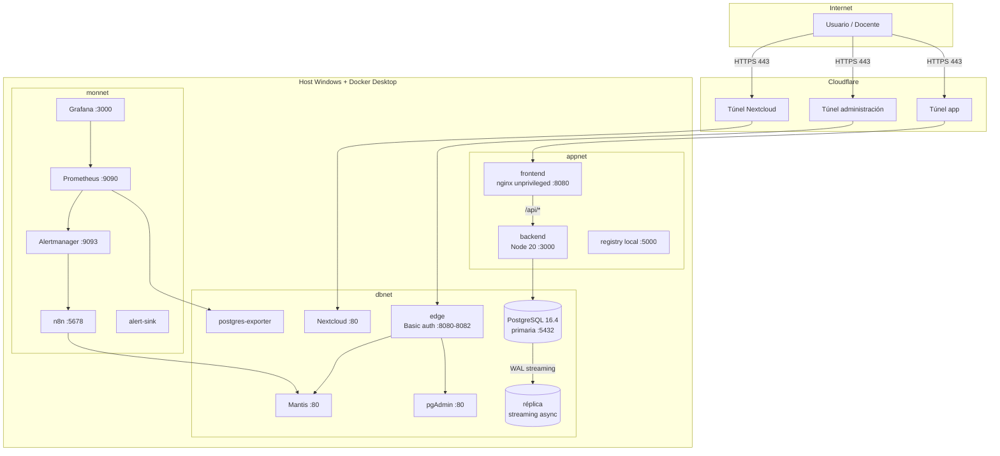
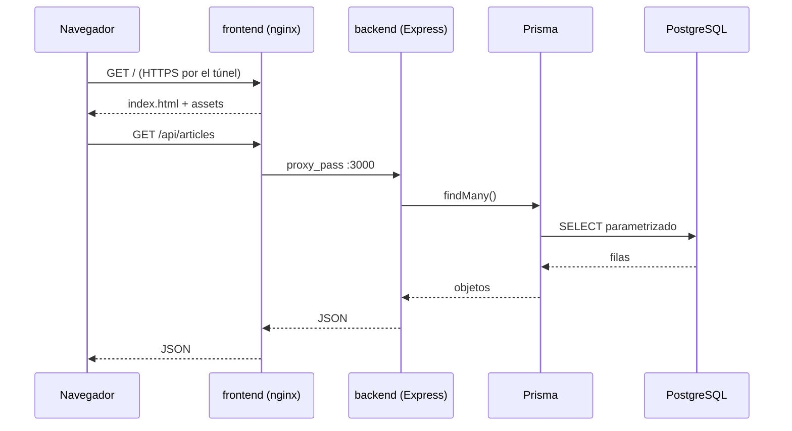
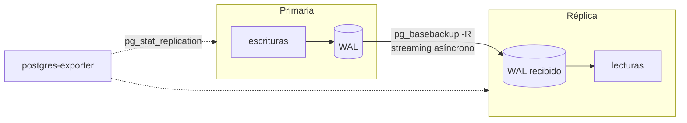
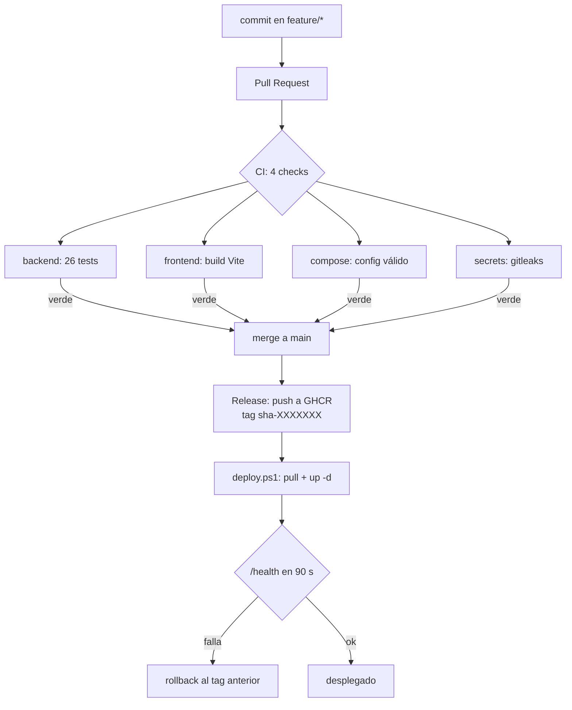
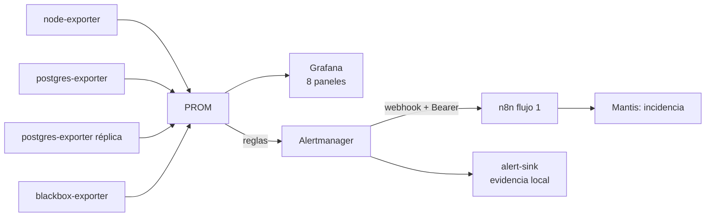
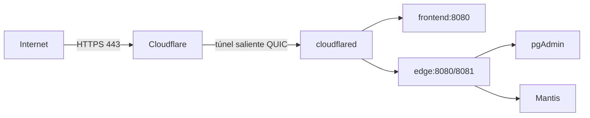

# 02 — Arquitectura general

Este documento describe **lo que está desplegado hoy**, no la arquitectura ideal. Cada componente
de los diagramas existe en `compose.yaml` y se puede verificar con `docker compose ps`.

## 1. Vista de despliegue

Cinco contenedores de aplicación (`frontend`, `backend`, `db`, `db-replica`, `pgadmin`) y ocho de
operación (`mantis`, `nextcloud`, `prometheus`, `alertmanager`, `grafana`, `n8n`, `edge`, `registry`),
más cuatro exporters. Todos los puertos publicados están en `127.0.0.1`.

## 2. Componentes y responsabilidades

| Componente | Responsabilidad | Tecnología | Puerto |
|---|---|---|---|
| `frontend` | SPA; sirve estático y proxea `/api` al backend | Vite 5 + React 18 → nginx 1.27 unprivileged | `127.0.0.1:8090` |
| `backend` | API REST del dominio; JWT; healthcheck con ping a la base | Node 20 + Express 4 + Prisma 4 | ninguno (`expose 3000`) |
| `db` | Persistencia y origen de la replicación | PostgreSQL 16.4 | `127.0.0.1:5433` |
| `db-replica` | Réplica de solo lectura por streaming asíncrono | PostgreSQL 16.4 | ninguno |
| `pgadmin` | Administración de la base | pgAdmin 8 | `127.0.0.1:8080` |
| `mantis` | Gestión de incidencias (§11) | MantisBT 2.28.4 sobre PostgreSQL | `127.0.0.1:8081` |
| `nextcloud` | Gestión documental con permisos por grupo (§12) | Nextcloud 30 sobre PostgreSQL | `127.0.0.1:8082` |
| `prometheus` | Recolección y evaluación de reglas | Prometheus 2.54 | `127.0.0.1:9090` |
| `alertmanager` | Agrupación, silencios y envío a n8n | Alertmanager 0.27 | `127.0.0.1:9093` |
| `grafana` | 8 paneles de observabilidad | Grafana 11 | `127.0.0.1:3001` |
| `n8n` | Automatización: alerta → incidencia | n8n 1.68 | `127.0.0.1:5678` |
| `edge` | Borde con Basic auth para las herramientas administrativas | nginx 1.27 | `127.0.0.1:8088-8091` |
| `registry` | Plan B de imágenes (si GHCR no está disponible) | registry 2 | `127.0.0.1:5000` |

## 3. Redes y exposición

| Servicio | Redes | Puerto publicado | Justificación |
|---|---|---|---|
| `frontend` | `appnet` | `127.0.0.1:8090` | único punto de entrada de la app |
| `backend` | `appnet`, `dbnet` | **ninguno** (`expose 3000`) | solo alcanzable desde el frontend |
| `db` | `dbnet` | `127.0.0.1:5433` | acceso local para desarrollo; en prod no se publica |
| `db-replica` | `dbnet` | **ninguno** | solo lectura, sin exposición |
| `pgadmin` | `dbnet` | `127.0.0.1:8080` | administración, jamás expuesta a Internet |
| `mantis` | `dbnet` | `127.0.0.1:8081` | perfil `ops`; acceso por el borde |
| `nextcloud` | `dbnet` | `127.0.0.1:8082` | perfil `ops`; túnel directo (login propio) |
| `prometheus` | `monnet`, `appnet`, `dbnet` | `127.0.0.1:9090` | necesita scrapear exporters de las tres redes |
| `n8n` | `appnet`, `dbnet`, `monnet` | `127.0.0.1:5678` | recibe webhooks y escribe en Mantis y en su base |

Las tres redes están aisladas entre sí: `appnet` no ve la base, `monnet` solo se cruza con las otras
para scrapear. `dbnet` **no** tiene `internal: true` porque el contenedor necesita resolver el DNS
de Docker y salir a Internet para `apt`/`npm` durante el build (decisión D-15).

Todas las publicaciones son en **loopback**: no hay un solo puerto escuchando en `0.0.0.0`.

## 4. Flujo de una petición

Un solo origen ⇒ **no hace falta CORS** (el `cors()` del backend queda como red de seguridad para
clientes externos, no como solución de arquitectura). El frontend agrega las cabeceras de seguridad
y el rate limit de `/api/` antes de llegar al backend.

## 5. Replicación

- Método: **streaming replication asíncrona** con `pg_basebackup -R`.
- `synchronous_commit=on` en la primaria: se prioriza integridad sobre latencia.
- **No hay failover automático.** Sin Patroni/repmgr nada se promueve solo. La promoción es manual,
  documentada y medida: **RTO 8,6 s** (§8).
- Métricas: `pg_stat_replication` (lag en bytes) y `pg_last_wal_replay_lsn()`.

## 6. CI/CD

`main` está protegida con los 4 checks en modo estricto y `enforce_admins`. El deploy es
**pull-based**: el host baja la imagen de GHCR y verifica `/health`; si no responde, vuelve sola al
tag anterior (`.deploy/state.json` guarda el historial).

## 7. Monitoreo y alertas

Reglas activas: `ServicioCaido` (2 min), `CPUAlta` (85%, 5 min), `MemoriaAlta` (90%, 5 min),
`DiscoCasiLleno`, `PostgresCaido` (1 min) y `ReplicacionAtrasada` (2 min). El flujo 1 está probado
de punta a punta: alerta real → incidencia #18 en Mantis.

## 8. Publicación en Internet

El host **no abre puertos**: el túnel es saliente. El TLS lo termina Cloudflare. Las herramientas
administrativas quedan detrás de HTTP Basic en `edge`, y además tienen su propio login.

| Servicio | Ruta pública | Autenticación |
|---|---|---|
| Aplicación | `https://<random>.trycloudflare.com` | login propio (JWT) |
| pgAdmin | `https://<random>.trycloudflare.com` | Basic auth + login de pgAdmin |
| Mantis | `https://<random>.trycloudflare.com` | Basic auth + login de Mantis |

## 9. Decisiones estructurales

| Decisión | Motivo | Registro |
|---|---|---|
| Backend sin puerto publicado | reduce superficie; el frontend es el único borde | D-08 |
| Redes separadas `appnet` / `dbnet` / `monnet` | el frontend no debe hablar con la base | §7 |
| Healthcheck con `SELECT 1` | un contenedor "up" con la base caída no es un servicio sano | §7 |
| Imágenes multi-stage | la imagen final no lleva toolchain ni devDependencies | §14 |
| Frontend unprivileged (uid 101, :8080) | un proceso comprometido no corre como root | §14 |
| Mantis en perfil `ops` | no compite por recursos con la demo principal | D-21 |
| Un solo motor (PostgreSQL) | menos superficie y menos servicios que mantener | D-03/D-21 |
| Failover manual | Patroni exige 3 nodos; se declara y se mide | D-04 |

## 10. Estado actual

Todo lo planificado para §6, §7, §9, §10, §12 y §13 está desplegado y verificado. Lo que no está:

- **Flujos 2 y 3 de n8n**: el 2 necesita una imagen con `postgresql-client`; el 3 está implementado
  pero no programado (ver `13-automatizacion.md`).
- **Failover automático**: fuera de alcance por diseño (D-04).
